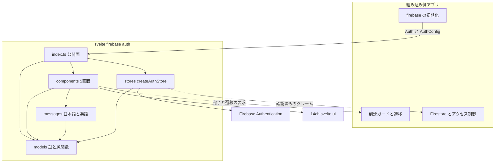
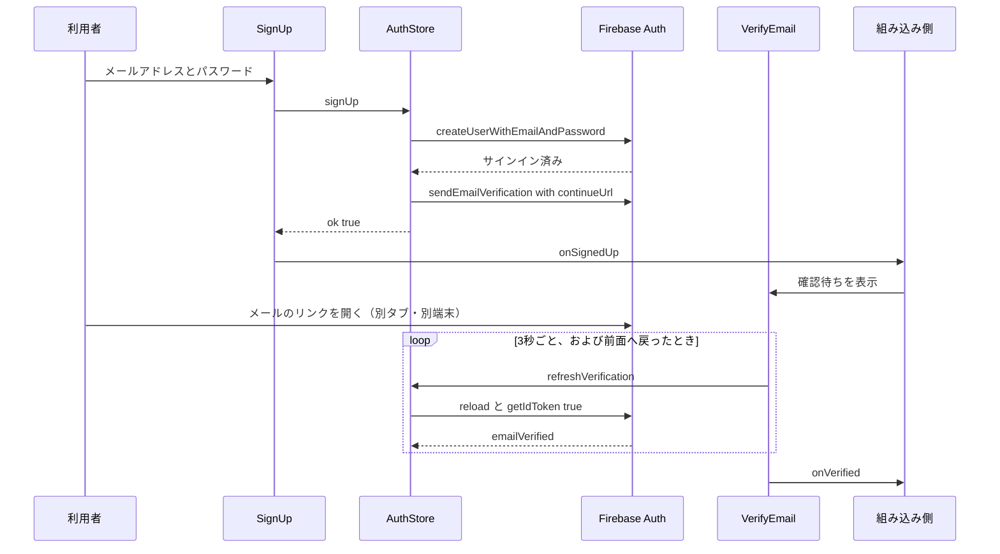
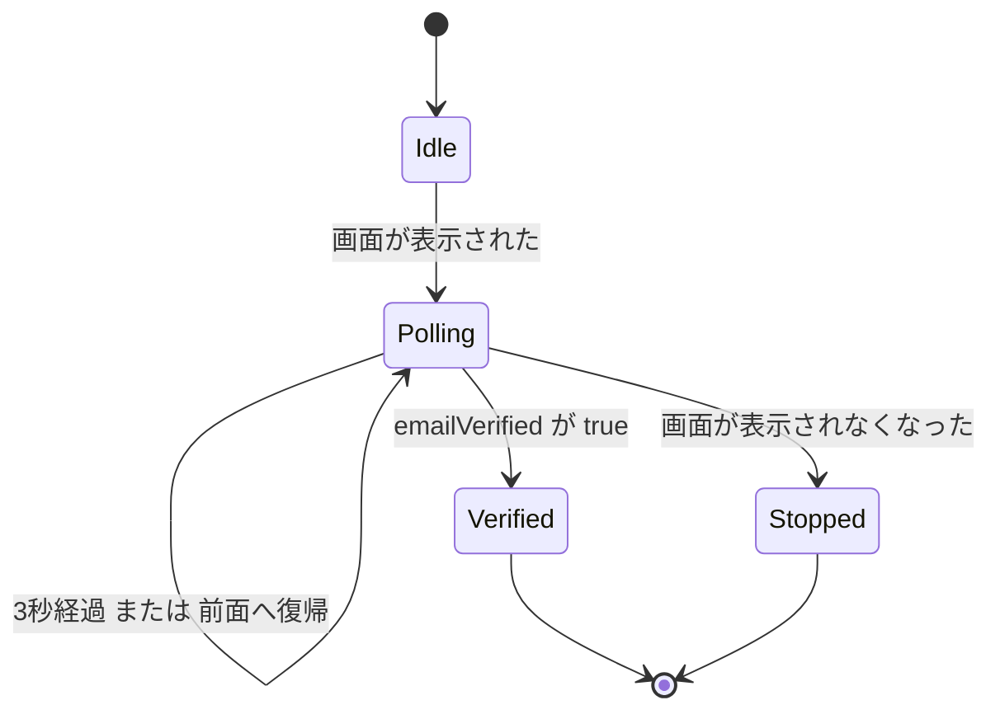
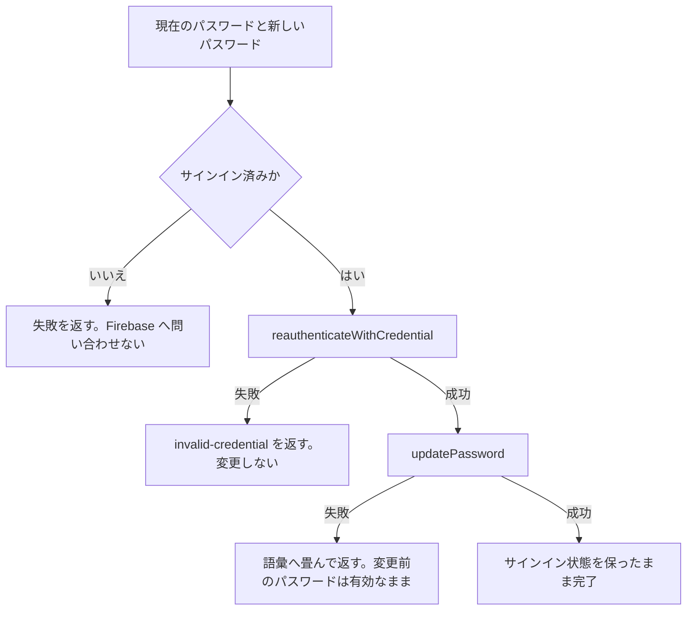

# Technical Design

## Overview

**Purpose**: Firebase Authentication のメールアドレスとパスワードによる認証について、**状態と操作を持つストア**と**5つの画面**を `@14ch/svelte-firebase-auth` として提供する。組み込み側に残すのは遷移と到達の判断だけにする。

**Users**: Firebase Authentication を使う Svelte 5 のアプリケーションの開発者。最初の組み込み先は `markn` だが、markn 専用ではない。

**Impact**: このリポジトリには認証の実装が無く（`sv` の雛形のみ）、本設計がライブラリの全体を定める。組み込み側から見ると、これまで各アプリが書いていた認証の処理と画面が1つのパッケージへ移る。

### Goals

- 認証の状態（サインイン・利用者・正規化済みのメールアドレス・確認済みか）を1箇所から読める形で公開する
- サインイン・登録・確認待ち・パスワードの変更・パスワードの再設定の5画面を、そのまま配置して使える単位で提供する
- Firebase のエラーコードを、利用者への案内が分かれる粒度の語彙へ畳んで返す。例外を投げない
- **メールアドレスの確認済みが、画面と組み込み側のアクセス制御の双方に届く状態にする**

### Non-Goals

- Firebase の初期化、遷移とルーティング、到達ガード、Firestore とアクセス制御（いずれも組み込み側）
- 自前のアクションハンドラ画面（確認・再設定のリンクを開いた先は Firebase の既定のハンドラに委ねる）
- 自前のメール配信経路の実装（送信の呼び出しを1箇所に閉じるにとどめる）
- メールリンクによるサインイン、メールアドレスの変更、外部の認証プロバイダ、二要素認証、アカウントの削除

## Boundary Commitments

### This Spec Owns

- **認証の状態** — `AuthStore` が公開する値。Firebase Auth の利用者から導かれるものだけを持ち、独自の永続データを持たない
- **Firebase Auth への操作** — サインイン／登録／サインアウト／パスワードの変更・再設定／確認メールの送信／確認状態の取り直し
- **エラーの語彙** — `AuthErrorKind` と、Firebase のエラーコードからの写像
- **メールアドレスの正規化** — `normalizeEmail`。組み込み側の照合とアクセス制御が同じ値を得るための唯一の出所
- **5画面のマークアップと画面内の状態** — 入力・検証中の表示・エラーの提示・確認待ちの取り直し
- **日本語と英語の文言と、項目単位の差し替えの仕組み**

### Out of Boundary

- **Firebase の初期化**（`Auth` を受け取る）と、Firebase コンソールの設定（承認済みドメイン・登録の受け付け・メールのテンプレート）
- **遷移・戻り先の解決・到達ガード** — 完了と遷移の要求はコールバックで返す。ライブラリは `$app/*` を import しない
- **確認済みをアクセス制御で要求すること** — ルールは組み込み側が書く
- **既存利用者の移行と運用者の作業**
- **メールの到達性**（SPF / DKIM / DMARC、送信元ドメイン）

### Allowed Dependencies

- `firebase/auth`（peer, P0）— 認証のみ。`firebase/firestore` に触れない
- `svelte`（peer, P0）— runes
- `@14ch/svelte-ui`（peer, P1）— 画面の部品とトークン
- 依存の向きは **models → messages → components** および **models → stores → components** の一方向。逆向きを作らない

### Revalidation Triggers

以下の変更は、組み込み側（markn ほか）に再検証を要求する。

- `AuthErrorKind` の増減 — 文言の網羅に波及する。**本設計は markn design の8種から10種へ広げている**（`registration-disabled` / `network-error`）
- `AuthStore` / `AuthConfig` / 画面の props の形の変更（**`AuthStage` の段階の増減を含む**。組み込み側の分岐の網羅に波及する）
- 確認済みの反映の方法の変更（組み込み側のアクセス制御の成立に直結する）
- peer 依存の版の要求の変更

## Architecture

### Existing Architecture Analysis

このリポジトリは `sv create --template library` の雛形であり、認証の実装は存在しない（→ `gap-analysis.md`）。守るべき既存の構造は `structure.md` が定める配置だけである。`src/lib/vitest-examples/` は雛形の残骸で、`svelte-package` の対象に入るため削除する。

markn の実装からは、**購読も遷移も持たないもの**（`normalizeEmail`、結果の共用体の形、エラー写像の形、エミュレータの検証手法）を移植する。ストアと画面は新規に書く。markn のストアはモジュール単位のシングルトンであり、複数生成できる形と両立しない。

### Architecture Pattern & Boundary Map



**Architecture Integration**:

- **Selected pattern**: `structure.md` が定める層の分離（models → messages / stores → screens）。ports & adapters は差し替える相手が実在せず、「過剰な抽象化をしない」に反するため採らない（→ `research.md`）
- **Domain boundaries**: **Firebase Auth の呼び出しは `stores/` だけが行う。** 画面は `firebase/auth` を import しない。純関数と型は `models/` に閉じ、購読を持たない
- **New components rationale**: 5画面はいずれも利用者への提示が異なり、共通の部品へ吸わせない（`structure.md`「過度な共通化をしない」）
- **Steering compliance**: `$app/*` を import しない／例外を投げない／シングルトンにしない／独自のパレットを持たない

**依存の向き（違反は誤りとして扱う）**: `models` → `messages` → `screens`、`models` → `stores` → `screens`。`components` は `stores` を**型としてのみ**参照し、実体は props で受け取る。`models` はいずれの層も参照しない。

### Technology Stack

| Layer             | Choice / Version                           | Role in Feature                        | Notes                                                                       |
| ----------------- | ------------------------------------------ | -------------------------------------- | --------------------------------------------------------------------------- |
| Frontend          | Svelte 5.56+（runes）                      | 画面と状態                             | `$state` / `$derived` / `$effect`。peer                                     |
| Auth SDK          | `firebase` 12.17+（`firebase/auth` のみ）  | 認証の操作と購読                       | **peer。新規の依存**。`firebase/firestore` に触れない                       |
| UI 部品           | `@14ch/svelte-ui` 0.0.60+                  | 入力・操作・意匠のトークン             | **peer。新規の依存**。`Input` は `type="password"` と表示切り替えに対応済み |
| Build / Packaging | `@sveltejs/package` + Vite 8               | `src/lib` → `dist`（`.svelte` のまま） | 既存。`publint` を `prepack` に含む                                         |
| Test              | Vitest 4（client / server / **emulator**） | 単体・コンポーネント・エミュレータ     | **`emulator` プロジェクトを追加**。`firebase.json` を新規作成               |
| Test (E2E)        | Playwright 1.60+                           | ショーケースの操作                     | 既存                                                                        |

**新規の依存**: `firebase` と `@14ch/svelte-ui` は peer で宣言し、ショーケースと型解決のため devDependencies にも入れる（peer は自動で導入されない）。

## File Structure Plan

### Directory Structure

```
src/lib/
├── index.ts                            # 公開面。ここに無いものは内部実装
├── models/auth/
│   ├── auth.types.ts                   # 型と型ガードのみ（公開する型を含む）
│   ├── auth.constants.ts               # エラーコードの写像表・取り直しの間隔
│   └── auth.ts                         # 純関数 normalizeEmail / toAuthError / unmetRequirementsOf
├── messages/
│   ├── ja.ts                           # 既定の日本語
│   ├── en.ts                           # 英語
│   ├── resolveMessages.ts              # 基準への差し替えの併合。言語を持たない
│   └── authErrorMessage.ts             # 語彙から利用者への文言を引く唯一の関数
├── stores/
│   └── auth.svelte.ts                  # createAuthStore。購読と寿命を持つ唯一の場所
└── screens/
    ├── SignIn.svelte
    ├── SignUp.svelte
    ├── VerifyEmail.svelte
    ├── PasswordChange.svelte
    └── PasswordReset.svelte

src/routes/                             # ショーケース。配布物に含めない
├── +layout.svelte                       # ストアの生成と start/stop、@14ch/svelte-ui のスタイル読み込み
├── firebase.ts                          # Firebase の初期化（組み込み側の書き方の実例）
└── +page.svelte                         # 5画面の切り替えと、コールバックの実例

src/tests/                              # 実装と対称の配置
├── models/auth/auth.test.ts
├── stores/auth.test.ts                 # モック
├── stores/auth.emulator.test.ts        # エミュレータ
└── screens/*.svelte.spec.ts
```

各画面は自分のマークアップ・入力の状態・エラーの提示を持ち、共通の入力欄部品を作らない（→ `research.md`「共通の入力欄部品を作らない」）。

### Modified Files

- `package.json` — `peerDependencies` に `firebase` / `@14ch/svelte-ui` を追加し、devDependencies にも同じものを入れる。`test:emulator` スクリプトを追加
- `vite.config.ts` — `emulator` プロジェクト（node 環境、`*.emulator.test.ts`）を追加
- `firebase.json` — **新規**。Auth エミュレータの設定のみ
- `README.md` — 組み込み側の設定（`optimizeDeps.exclude` / `resolve.dedupe`）、承認済みドメインの登録、Firebase 側の登録受け付け設定
- `src/lib/vitest-examples/` — **削除**（`svelte-package` の対象に入るため）
- `src/routes/demo/` — **削除**。ショーケースに置き換える

## System Flows

### 登録から、確認済みに到達するまで



**流れの上の決定**

- **確認メールの送信は `signUp` の中で行う**（要件 4.2）。画面が2手続きを順に呼ぶ形にすると、送信の失敗が登録の成否と混ざる。**`emailVerification: false` の組み込み先では送らない**（要件 1.11）
- **確認の完了は購読では届かない。** `onAuthStateChanged` も `onIdTokenChanged` も発火しないため、取り直しが唯一の検知手段である（→ `research.md`）
- **リンクを開いた先の処理はライブラリの外**。Firebase の既定のアクションハンドラが行い、その後 `continueUrl` へ進む

### 確認待ちの取り直しの寿命



停止は `$effect` のクリーンアップで行う。**停止し損ねると、画面を離れた後も通信が続く**（要件 5.6）。

### パスワードの変更（再認証を伴う）



再認証を先に行うため、`requires-recent-login` は通常起きない。写像には残し、起きた場合は現在のパスワードの入力を促す（要件 6.2 と同じ案内）。

## Requirements Traceability

| Requirement   | Summary                                    | Components                       | Interfaces                                                                            | Flows                |
| ------------- | ------------------------------------------ | -------------------------------- | ------------------------------------------------------------------------------------- | -------------------- |
| 1.1–1.5, 1.10 | 公開面・初期化しない・遷移しない・複数生成 | PublicSurface, AuthStoreFactory  | `createAuthStore`, `AuthConfig`                                                       | Boundary Map         |
| 1.6           | メールリンクを備えない                     | AuthStoreFactory                 | —                                                                                     | —                    |
| 1.7           | メールアドレスの正規化                     | AuthModels                       | `normalizeEmail`                                                                      | —                    |
| 1.8           | 送信経路の差し替えの余地                   | AuthStoreFactory                 | 送信は `signUp` / `sendEmailVerification` / `sendPasswordReset` の内部の1箇所に閉じる | —                    |
| 1.9           | 継続 URL の反映                            | AuthStoreFactory                 | `AuthConfig.continueUrl`                                                              | 登録から確認済みまで |
| 2.1–2.7       | 公開する状態と追随                         | AuthStoreFactory                 | `AuthStore`                                                                           | —                    |
| 2.8–2.10      | 確認状態の取り直しと多重実行の抑止         | AuthStoreFactory                 | `refreshVerification`                                                                 | 取り直しの寿命       |
| 2.11          | 購読の開始と停止                           | AuthStoreFactory                 | `start`, `stop`                                                                       | —                    |
| 3.1–3.9       | サインインとサインアウト                   | SignIn, AuthStoreFactory         | `SignInProps`, `signIn`, `signOut`                                                    | —                    |
| 4.1–4.8       | 登録と自由登録の可否                       | SignUp, AuthStoreFactory         | `SignUpProps`, `signUp`, `canSelfRegister`                                            | 登録から確認済みまで |
| 5.1–5.10      | 確認と確認待ち画面                         | VerifyEmail, AuthStoreFactory    | `VerifyEmailProps`, `sendEmailVerification`                                           | 取り直しの寿命       |
| 6.1–6.8       | パスワードの変更                           | PasswordChange, AuthStoreFactory | `PasswordChangeProps`, `changePassword`                                               | パスワードの変更     |
| 7.1–7.6       | パスワードの再設定                         | PasswordReset, AuthStoreFactory  | `PasswordResetProps`, `sendPasswordReset`                                             | —                    |
| 8.1–8.6       | エラーの語彙と返し方                       | AuthModels, AuthMessages         | `AuthResult`, `AuthError`, `AuthErrorKind`, `authErrorMessageOf`                      | —                    |
| 9.1–9.9       | 画面の契約と文言                           | AuthScreens, AuthMessages        | `AuthBaseProps`, `AuthMessages`                                                       | —                    |
| 10.1–10.5     | 配布の形と手引き                           | PackagingAndShowcase             | `package.json`, README                                                                | —                    |

## Components and Interfaces

| Component            | Domain/Layer   | Intent                                                   | Req Coverage                                 | Key Dependencies                         | Contracts      |
| -------------------- | -------------- | -------------------------------------------------------- | -------------------------------------------- | ---------------------------------------- | -------------- |
| AuthModels           | models         | 型・語彙・純関数                                         | 1.7, 8                                       | —                                        | Service        |
| AuthMessages         | messages       | 日本語と英語、項目単位の差し替え、語彙から文言を引く関数 | 8.5, 9.4, 9.5                                | AuthModels (P0)                          | Service        |
| AuthStoreFactory     | stores         | 認証状態の保持と Firebase Auth への操作                  | 1.1–1.10, 2, 3.1, 3.6, 4.1, 4.2, 5.1, 6, 7.1 | firebase/auth (P0), AuthModels (P0)      | Service, State |
| SignIn               | screens        | サインインの画面                                         | 3.2–3.5, 3.7–3.9                             | AuthStoreFactory (P0), AuthMessages (P0) | —              |
| SignUp               | screens        | 登録の画面                                               | 4.3–4.7                                      | 同上                                     | —              |
| VerifyEmail          | screens        | 確認待ちの画面と、確認の検知                             | 5.2–5.10                                     | 同上                                     | State          |
| PasswordChange       | screens        | パスワードの変更の画面                                   | 6.2, 6.3, 6.5, 6.8                           | 同上                                     | —              |
| PasswordReset        | screens        | パスワードの再設定の画面                                 | 7.2–7.6                                      | 同上                                     | —              |
| PublicSurface        | index          | 組み込み側が依存してよい面                               | 1.4, 1.5, 8.6                                | すべて (P0)                              | —              |
| PackagingAndShowcase | build / routes | 配布の形・README・ショーケース                           | 10                                           | —                                        | —              |

### models

#### AuthModels

| Field        | Detail                                         |
| ------------ | ---------------------------------------------- |
| Intent       | 型・エラーの語彙・純関数。購読も遷移も持たない |
| Requirements | 1.7, 8.1–8.6                                   |

**Responsibilities & Constraints**

- 公開する型のすべてをここに置く（`structure.md`「型定義の規約」）。`.types.ts` は型と型ガードのみで、変換関数を置かない
- Firebase のエラーコードから語彙への写像を持つ。**コードをそのまま透過させない**（要件 8.3）
- `normalizeEmail` は組み込み側の照合とアクセス制御が同じ値を得るための唯一の出所

**Dependencies**

- External: `firebase/auth` — `User` / `Auth` / `PasswordValidationStatus` の**型のみ**（P0）

**Contracts**: Service [x] / API [ ] / Event [ ] / Batch [ ] / State [ ]

##### Service Interface

```typescript
import type { Auth, User, PasswordValidationStatus } from 'firebase/auth';

/** 利用者への案内が分かれる粒度だけを区別する */
export type AuthErrorKind =
	| 'invalid-credential'
	| 'invalid-email'
	| 'email-already-in-use'
	| 'weak-password'
	| 'requires-recent-login'
	| 'user-disabled'
	| 'too-many-requests'
	| 'registration-disabled'
	| 'network-error'
	| 'unknown';

/** 満たしていないパスワードの要件。`weak-password` のときだけ値が入る */
export type PasswordRequirement =
	'min-length' | 'max-length' | 'lowercase' | 'uppercase' | 'numeric' | 'non-alphanumeric';

export interface AuthError {
	readonly kind: AuthErrorKind;
	/** 原因の詳細。利用者へ直接は出さず、組み込み側の記録に用いる */
	readonly detail: string;
	/** 満たしていない要件。該当しない場合と取得できなかった場合は空 */
	readonly unmetPasswordRequirements: readonly PasswordRequirement[];
}

export type AuthResult = { readonly ok: true } | { readonly ok: false; readonly error: AuthError };

export interface AuthConfig {
	/** 登録の入口を画面に出すか。登録 API そのものは組み込み側が Firebase 側の設定で塞ぐ */
	readonly selfRegistration: boolean;
	/** メールアドレスの確認を求めるか。求めない場合、登録の後に確認メールを送らない */
	readonly emailVerification: boolean;
	/** 確認と再設定の完了後に戻る URL。組み込み側の承認済みドメインである必要がある */
	readonly continueUrl: string;
}

/** 前後の空白を落とし、小文字へ揃える */
export declare function normalizeEmail(email: string): string;

/** 未知の失敗を語彙へ畳む。FirebaseError 以外も受け取る */
export declare function toAuthError(
	error: unknown,
	unmetPasswordRequirements?: readonly PasswordRequirement[]
): AuthError;

/** 充足状況から、満たしていない要件だけを取り出す。undefined の項目は要求されていない */
export declare function unmetRequirementsOf(
	status: PasswordValidationStatus
): readonly PasswordRequirement[];
```

- **Preconditions**: なし（いずれも純関数）
- **Postconditions**: `toAuthError` は必ず `AuthError` を返し、例外を投げない
- **Invariants**: `normalizeEmail` は冪等である

**Implementation Notes**

- Integration: 写像表は `auth.constants.ts` に置く。`auth/user-not-found` と `auth/wrong-password` は `invalid-credential` へ、`auth/admin-restricted-operation` と `auth/operation-not-allowed` は `registration-disabled` へ、`auth/network-request-failed` は `network-error` へ畳む。`auth/password-does-not-meet-requirements` は SDK の定数に無いバックエンド由来の文字列だが、`weak-password` へ写す
- Validation: 写像表の全エントリと、未知のコードが `unknown` へ落ちることを単体テストで確かめる
- Risks: 語彙の追加は組み込み側の文言に波及する（→ Revalidation Triggers）

### messages

#### AuthMessages

| Field        | Detail                                       |
| ------------ | -------------------------------------------- |
| Intent       | 画面に出す日本語と英語と、項目単位の差し替え |
| Requirements | 9.4, 9.5                                     |

**Responsibilities & Constraints**

- **平坦な型**とし、差し替えは浅い併合で行う。**例外は `errors` の1つだけ**で、ここは `AuthErrorKind` をキーとする表にする。`Record<AuthErrorKind, string>` にすることで、**語彙を増やしたときに既定の文言の追加を型が強制する**（平坦なキーでは、追加した語彙に対応する文言が無いまま通ってしまう）
- **失敗から文言を引く分岐を `authErrorMessageOf` の1箇所に閉じる。** 画面はこの関数を呼ぶだけで、エラーの文言も、語彙ごとの分岐も、画面ごとの例外も持たない
- 値を差し込む文言は関数の項目にする。文字列の連結を画面に書かない
- **文言をコンポーネントに直接書かない**（`structure.md`）

**Contracts**: Service [x] / API [ ] / Event [ ] / Batch [ ] / State [ ]

##### Service Interface

```typescript
import type { PasswordRequirement } from '$lib/models/auth/auth.types';

export interface AuthMessages {
	// 入力欄（placeholder と読み上げの名前）
	readonly email: string;
	readonly password: string;
	readonly currentPassword: string;
	readonly newPassword: string;

	// 送信
	readonly signInSubmit: string;
	readonly signUpSubmit: string;
	readonly passwordChangeSubmit: string;
	readonly passwordResetSubmit: string;

	// 移動（抜粋）。行き先の画面を名にする。出発した画面は名に持たない
	readonly goToSignUp: string;
	readonly goToPasswordReset: string;
	readonly backToSignIn: string;

	// 確認待ち
	readonly verifyEmailSentTo: (email: string) => string;
	readonly verifyEmailResend: string;
	readonly goToSignUpWithAnotherEmail: string;

	/** 確認待ちと再設定の、どちらの送信の後にも出す */
	readonly checkSpam: string;

	/** 語彙ごとの既定の案内。すべての語彙に対応する項目を持つ */
	readonly errors: Readonly<Record<AuthErrorKind, string>>;
	/** 画面によって案内が分かれるものだけ、専用の項目を持つ */
	readonly currentPasswordInvalid: string;
	readonly weakPasswordReason: (requirements: readonly PasswordRequirement[]) => string;
}

/** 差し替え。`errors` だけは語彙単位で差し替えられる */
export type AuthMessagesOverride = Partial<Omit<AuthMessages, 'errors'>> & {
	readonly errors?: Partial<Record<AuthErrorKind, string>>;
};

/** 既定の日本語 */
export declare const jaMessages: AuthMessages;

/** 英語 */
export declare const enMessages: AuthMessages;

/** 指定された項目だけを差し替える。指定のない項目は基準（既定は日本語）を用いる */
export declare function resolveMessages(
	overrides?: AuthMessagesOverride,
	base?: AuthMessages
): AuthMessages;

/** 同じ語彙でも案内が分かれる画面を区別する */
export type AuthErrorContext =
	'sign-in' | 'sign-up' | 'verify-email' | 'password-change' | 'password-reset';

/**
 * 失敗から利用者への文言を引く唯一の関数。
 * 画面はこれを呼ぶだけで、エラーの文言も分岐も持たない
 */
export declare function authErrorMessageOf(
	error: AuthError,
	messages: AuthMessages,
	context: AuthErrorContext
): string;
```

- **Postconditions**: `resolveMessages` は常にすべての項目が埋まった `AuthMessages` を返す
- **Invariants**: 併合は `errors` を除いて1段。`errors` は語彙単位で併合する。`overrides` に無い項目が既定から欠けることはない

**Implementation Notes**

- Integration: `authErrorMessageOf` が持つ分岐は3つだけである。`weak-password` は `weakPasswordReason(error.unmetPasswordRequirements)` を返す。`invalid-credential` を `password-change` の文脈で受けたときは `errorCurrentPasswordInvalid` を返す。それ以外は `errors[kind]` を引く
- Integration: 語彙の追加は `errors` の項目の追加を伴い、既定の文言が無ければ型が通らない。**組み込み側の差し替えは `Partial` なので、追加しても壊れない**
- Integration: **`authErrorMessageOf` は公開面から export する。** 組み込み側がストアを直接呼んで自前の画面を出す場合にも、同じ文言を使えるようにする
- Risks: 項目の追加は組み込み側にとって破壊的変更ではない（差し替えは `Partial` のため）が、**削除と改名は破壊的変更**である

### stores

#### AuthStoreFactory

| Field        | Detail                                                                              |
| ------------ | ----------------------------------------------------------------------------------- |
| Intent       | 認証状態の保持と、Firebase Auth への操作。購読と寿命を持つ唯一の場所                |
| Requirements | 1.1–1.3, 1.6, 1.9, 1.10, 2.1–2.11, 3.1, 3.6, 4.1, 4.2, 5.1, 6.1, 6.4, 6.6, 6.7, 7.1 |

**Responsibilities & Constraints**

- **`Auth` を受け取り、初期化しない。** グローバルな状態を持たず、複数生成できる（要件 1.1、1.10）
- **Firebase Auth の呼び出しはここだけが行う。** 画面は `firebase/auth` を import しない
- **例外を投げない。** すべての操作は `AuthResult` か真偽値を返す
- `email` は常に正規化済み。`isResolved` は単調（一度 `true` になったら戻らない）
- **メールリンクに関する API を一切呼ばない**（要件 1.6）

**Dependencies**

- External: `firebase/auth` — 認証の操作と購読（P0）
- Outbound: AuthModels — 語彙への写像と正規化（P0）

**Contracts**: Service [x] / API [ ] / Event [ ] / Batch [ ] / State [x]

##### Service Interface

```typescript
import type { Auth, User } from 'firebase/auth';
import type { AuthConfig, AuthResult } from '$lib/models/auth/auth.types';

export interface AuthStore {
	readonly user: User | null;
	/** 初回の認証状態の判定が完了したか。一度 true になったら false へ戻らない */
	readonly isResolved: boolean;
	readonly isLoggedIn: boolean;
	/** 正規化済みのメールアドレス。組み込み側の照合とアクセス制御に一致する */
	readonly email: string | null;
	readonly isEmailVerified: boolean;
	readonly canSelfRegister: boolean;
	readonly requiresEmailVerification: boolean;
	/** 認証の段階。到達の判断はこれを見る */
	readonly stage: AuthStage;

	signIn(email: string, password: string): Promise<AuthResult>;
	/** 成功時はサインイン済みにし、確認メールを送る */
	signUp(email: string, password: string): Promise<AuthResult>;
	signOut(): Promise<void>;
	/** 現在のパスワードによる再認証を伴う */
	changePassword(currentPassword: string, nextPassword: string): Promise<AuthResult>;
	/** 登録の有無にかかわらず同じ結果を返す */
	sendPasswordReset(email: string): Promise<AuthResult>;
	sendEmailVerification(): Promise<AuthResult>;
	/** 利用者と ID トークンのクレームを取り直し、確認済みかどうかを返す */
	refreshVerification(): Promise<boolean>;
	/** 認証状態の購読を開始する。既に開始していれば張り直す */
	start(): void;
	/** 購読を解除し、公開している状態を初期化する */
	stop(): void;
}

export declare function createAuthStore(auth: Auth, config: AuthConfig): AuthStore;
```

- **Preconditions**: `auth` は初期化済みであること。`changePassword` と `sendEmailVerification` はサインイン済みであること
- **Postconditions**:
  - `signUp` は成功時にサインイン済みの状態にし、確認メールを送る。**アカウントの作成が成功していれば、確認メールの送信に失敗しても `{ ok: true }` を返す**
  - `changePassword` は失敗時に変更前のパスワードを有効なまま保つ
  - `sendPasswordReset` は `auth/user-not-found` を受けても `{ ok: true }` を返す
  - `start` を呼ぶまで購読は始まらず、`isResolved` は `false` のまま
  - `stop` の後は状態が更新されず、`isResolved` は `false` へ戻る
- **Invariants**: `email` は常に正規化済み。`isResolved` は**1回の購読の中で**単調（`stop` による初期化は購読の終了であり、単調性の破れではない）

##### State Management

- **状態モデル**: `user` / `isResolved` / `isEmailVerified` を runes の状態として保持する。`isLoggedIn` / `email` は `user` から導く。`canSelfRegister` は設定から導く（状態を持たない）
- **`isEmailVerified` を `user.emailVerified` から導かない理由**: `$state` がプロキシするのは prototype が `Object.prototype` / `Array.prototype` のものだけであり（`svelte/src/internal/client/proxy.js`）、**Firebase の `User` はクラスのインスタンスなのでプロキシされない**。`reload(user)` は同じインスタンスの `emailVerified` を書き換えるだけなので、`user` から導いた値は追随しない。**独立した `$state` として持ち、`refreshVerification` と `onAuthStateChanged` の双方で明示的に設定する**
- **確認済みの反映**: `refreshVerification` は `reload(user)` の後に `getIdToken(user, true)` を行う。**片方だけでは、画面は進むのに組み込み側のアクセス制御が古い値のまま残る**（→ `research.md`）
- **並行性**: 実行中の `refreshVerification` があれば、その Promise を共有して追加の問い合わせを行わない（要件 2.9）
- **寿命**: `start()` で購読を開始し、`stop()` で解除して状態を初期化する。**markn の `onSnapshot` を持つストア（`documentsStore` / `userFoldersStore`）と同じ形**であり、`start()` は先頭で `stop()` を呼んで冪等にする。組み込み側は `+layout.svelte` の `$effect` に寿命を束ねられる
- **生成と開始を分ける理由**: 生成できて終わらせられない対を作らない。複数生成できる以上（要件 1.10）、捨てたストアの購読が生き続けると、誰も見ていない状態を書き換え続ける漏れになる。エミュレータのテストではテストごとに実ストアを作るため、この漏れはテスト間の干渉として実際に現れる

**Implementation Notes**

- Integration: `sendEmailVerification` と `sendPasswordReset` は `{ url: config.continueUrl }` を `ActionCodeSettings` として渡す。`handleCodeInApp` は指定しない（既定の `false`。web の既定のアクションハンドラを経由する）
- Integration: **確認メールの送信の失敗を、登録の失敗として返さない。** 失敗を返すと、実際にはアカウントができてサインインしている状態で「登録に失敗しました」と示すことになり、利用者は登録し直して `email-already-in-use` に当たる。回復の手段は確認待ち画面の再送が持つ（要件 5.4）
- Integration: 強度の失敗（`auth/weak-password` / `auth/password-does-not-meet-requirements`）を受けたときだけ `validatePassword(auth, password)` を呼び、満たしていない要件を `AuthError` に添える。取得に失敗したら空のまま返す
- Validation: エミュレータで、登録 → 確認メールの送出 → 別セッションでの確認 → `refreshVerification` による反映を確かめる。`too-many-requests` はモックで確かめる
- Risks: **`start()` の呼び忘れは `isResolved` が永久に `false` のままになる**（組み込み側は読み込み中の表示から進まない）。markn の `documentsStore` と同じ危うさであり、README とショーケースで書き方を示して補う

### components

5画面はいずれも**マークアップと画面内の状態だけ**を持ち、新しい境界を作らない。共通の props は基底の型に集約し、画面ごとの差分だけを足す。

##### 共通の props

```typescript
import type { Snippet } from 'svelte';
import type { AuthStore } from '$lib/stores/auth.svelte';
import type { AuthMessages } from '$lib/messages/ja';

export interface AuthBaseProps {
	readonly store: AuthStore;
	/** 渡さなかった項目は同梱の日本語を使う */
	readonly messages?: AuthMessagesOverride;
	/** 画面の上部へ差し込む要素。組み込み側の名乗り（題字など）を置く */
	readonly header?: Snippet;
}

export interface SignInProps extends AuthBaseProps {
	readonly onSignedIn: () => void;
	readonly onRequestPasswordReset: () => void;
	/** 自由登録が許可されているときだけ呼ばれる */
	readonly onRequestSignUp?: () => void;
}

export interface SignUpProps extends AuthBaseProps {
	readonly onSignedUp: () => void;
	readonly onRequestSignIn: () => void;
}

export interface VerifyEmailProps extends AuthBaseProps {
	readonly onVerified: () => void;
	readonly onSignOut: () => void;
	/** サインアウトを終えてから呼ばれる */
	readonly onRequestSignUpWithAnotherEmail: () => void;
}

export interface PasswordChangeProps extends AuthBaseProps {
	readonly onChanged: () => void;
	readonly onCancel: () => void;
}

export interface PasswordResetProps extends AuthBaseProps {
	readonly onRequested: () => void;
	readonly onRequestSignIn: () => void;
}
```

**すべての画面に共通する制約**（要件 9.2, 9.3, 9.7–9.9）

- `store` を props で受け取り、`firebase/auth` を直接呼ばない
- **エラーの文言を持たない。** 失敗を受けたら `authErrorMessageOf(error, messages, context)` を呼ぶだけにする。語彙ごとの分岐を画面に書かない
- 遷移を自身で行わず、完了と遷移の要求をコールバックで返す
- 処理中は操作の重複した実行を受け付けない（要件 3.4 を全画面へ適用する）
- 失敗しても入力した内容を失わせない
- 意匠の値は `--svelte-ui-*` を参照し、独自のパレットを持たない。**ブラウザ標準のダイアログを使わない**
- 画面全体を占める前提の外形を持たない（`position: fixed` を使わない）

#### VerifyEmail

唯一、画面が状態の寿命を持つため詳細を示す。

| Field        | Detail                           |
| ------------ | -------------------------------- |
| Intent       | 確認待ちの提示と、確認済みの検知 |
| Requirements | 5.2–5.10                         |

**Responsibilities & Constraints**

- 送信先のメールアドレスを示し、迷惑メールフォルダの確認を促す
- 確認メールの再送・別のメールアドレスでの登録し直し・サインアウトの3つを置く
- **表示されている間だけ**、3秒間隔と前面への復帰を契機に `refreshVerification` を呼ぶ。**表示されなくなったら止める**
- 「別のメールアドレスで登録し直す」は**サインアウトを終えてから**コールバックを呼ぶ

**Contracts**: State [x]

##### State Management

- **状態モデル**: 取り直しのタイマーと `visibilitychange` の購読を `$effect` の中で開始し、**クリーンアップで確実に解除する**
- **間隔**: 3秒。公開面の設定にしない（→ `research.md`）
- **頻度の超過**: 再送が `too-many-requests` を返したら、間隔を空けるよう示し、再送の操作を一時的に受け付けない（要件 5.8）

**Implementation Notes**

- Integration: 別の端末・別のタブで確認を済ませた場合にも成立する。前面への復帰を契機に加えているのはこのため
- Validation: エミュレータで、別セッションでの確認が待機側へ反映されることを確かめる。画面を離れた後に取り直しが止まることをコンポーネントのテストで確かめる
- Risks: 停止し損ねると、画面を離れた後も通信が続く

### index / build

#### PublicSurface

**Responsibilities & Constraints**

- 組み込み側が依存してよい面のすべて。**ここに export されていないものは内部実装**であり、いつ変えてもよい
- 深い import を組み込み側に強いない（要件 1.4）
- 公開する値に対応する型を必ず併せて export する（要件 1.5、8.6）

```typescript
export { createAuthStore } from './stores/auth.svelte';
export { normalizeEmail } from './models/auth/auth';
export { jaMessages, resolveMessages } from './messages/ja';
export { authErrorMessageOf } from './messages/authErrorMessage';

export { default as SignIn } from './components/SignIn.svelte';
export { default as SignUp } from './components/SignUp.svelte';
export { default as VerifyEmail } from './components/VerifyEmail.svelte';
export { default as PasswordChange } from './components/PasswordChange.svelte';
export { default as PasswordReset } from './components/PasswordReset.svelte';

export type {
	AuthStore,
	AuthConfig,
	AuthResult,
	AuthError,
	AuthErrorKind,
	PasswordRequirement,
	AuthMessages,
	AuthMessagesOverride,
	AuthErrorContext,
	AuthBaseProps,
	SignInProps,
	SignUpProps,
	VerifyEmailProps,
	PasswordChangeProps,
	PasswordResetProps
} from './models/auth/auth.types';
```

#### PackagingAndShowcase

**Responsibilities & Constraints**（要件 10.1–10.5）

- README に、組み込み側の `vite.config.ts` の設定（`optimizeDeps.exclude` と `resolve.dedupe: ['svelte']`）、**継続 URL のドメインを承認済みドメインへ登録すること**、自由登録を Firebase 側でも揃えることを書く
- ショーケース（`src/routes/`）は5画面を実際に操作でき、Firebase の初期化と遷移の書き方の実例として機能する。**配布物に含めない**
- `firebase` / `svelte` / `@14ch/svelte-ui` を peer で宣言する

**Implementation Notes**

- Integration: ショーケースは Auth エミュレータへ接続できる形にする（本番のプロジェクトへ繋がない）
- Validation: `publint` が `prepack` で走る。`npm link` による markn での組み込みを、最初の実地の検証とする

## Data Models

**新しい永続データを持たない。** 認証の状態は Firebase Authentication の利用者が持つ事実であり、ライブラリは写しを持たない。

- **確認済みの状態**: `User.emailVerified`（利用者の属性）と ID トークンの `email_verified`（クレーム）の2箇所に現れる。**ライブラリはどちらも保存せず、取り直して読む**
- **不変条件**: 組み込み側の照合に使うメールアドレスは、`normalizeEmail` を通した値と、アクセス制御の `.lower()` の結果が一致する
- **画面内の状態**（入力値・処理中・エラー）は画面の寿命に閉じ、ストアへ持ち上げない

## Error Handling

### Error Strategy

Firebase のエラーコードを、**利用者への案内が分かれる粒度**だけに畳んで返す（要件 8.2）。例外を投げず、`AuthResult` の判別可能な共用体で返す。**語彙から利用者への文言を引くのは `authErrorMessageOf` の1箇所だけ**であり、画面はエラーの文言も分岐も持たない。同じ語彙でも案内が分かれる画面は、この関数が文脈で区別する。

### Error Categories and Responses

| 種別               | `AuthErrorKind`         | 主な Firebase のコード                                                  | 応答                                                                                         |
| ------------------ | ----------------------- | ----------------------------------------------------------------------- | -------------------------------------------------------------------------------------------- |
| 資格情報の誤り     | `invalid-credential`    | `auth/invalid-credential`, `auth/user-not-found`, `auth/wrong-password` | サインインではどちらが違うかを示さない。パスワードの変更では「現在のパスワードが違う」と示す |
| 形式の誤り         | `invalid-email`         | `auth/invalid-email`                                                    | 該当の入力欄に示し、入力内容を保つ                                                           |
| 登録済み           | `email-already-in-use`  | `auth/email-already-in-use`                                             | 既に使われていることを示し、パスワードの再設定へ導く                                         |
| 強度の不足         | `weak-password`         | `auth/weak-password`, `auth/password-does-not-meet-requirements`        | **満たしていない要件を列挙して示す**。入力内容を保つ                                         |
| 再認証が必要       | `requires-recent-login` | `auth/requires-recent-login`                                            | 現在のパスワードの入力を求める                                                               |
| 停止された利用者   | `user-disabled`         | `auth/user-disabled`                                                    | 利用できないことを示す                                                                       |
| 頻度の超過         | `too-many-requests`     | `auth/too-many-requests`                                                | 間隔を空けるよう示し、その操作を一時的に受け付けない                                         |
| 登録が塞がれている | `registration-disabled` | `auth/admin-restricted-operation`, `auth/operation-not-allowed`         | 登録を受け付けていないことを示す。**設定の食い違いの兆候である**                             |
| 通信の失敗         | `network-error`         | `auth/network-request-failed`                                           | 通信を確かめて再試行するよう示す                                                             |
| その他             | `unknown`               | 上記以外（`auth/unauthorized-continue-uri` を含む）                     | 失敗したことを示し、再試行できる状態を保つ                                                   |

**登録の有無を漏らさない**: `sendPasswordReset` は `auth/user-not-found` を成功として畳む（要件 7.2）。組み込み先の `enableImprovedEmailPrivacy` の設定に依存させない。

### Monitoring

ライブラリは記録の手段を持たない。`AuthError.detail` に原因の文字列を残し、記録するかどうかは組み込み側が決める。**`registration-disabled` と `unauthorized-continue-uri` は設定の食い違いの兆候**であり、README でその旨を示す。

## Testing Strategy

受け入れ条件は `requirements.md` から引く。各テストに対応する要件の項番を書く（`conventions.md`「テストの由来」）。

### Unit Tests（`server` プロジェクト）

- `normalizeEmail` の正規化（前後の空白・大文字小文字。冪等であること）— 1.7
- Firebase のエラーコードから `AuthErrorKind` への写像の全エントリと、未知のコードが `unknown` へ落ちること — 8.2, 8.3, 8.4
- `unmetRequirementsOf` が `undefined` の項目を理由に含めないこと — 4.4, 6.3
- `resolveMessages` が指定のない項目に既定を残すこと。`errors` を語彙単位で差し替えられること — 9.5
- **`authErrorMessageOf` が `AuthErrorKind` のすべてに対して文言を返すこと**（語彙を網羅する）と、`password-change` の文脈だけ `invalid-credential` の案内が変わること — 8.5
- `AuthStore` の状態遷移（`isResolved` の単調性、`email` が常に正規化済みであること）— 2.3, 2.4
- `start` が冪等であること（続けて呼んでも購読が二重にならない）と、`stop` の後に状態が更新されないこと — 2.11

### 実際の Firebase に当てる検証（`emulator` プロジェクト）

**モックでは書き手の想定しか確かめられない箇所に限る。** 対象は、Firebase が実際にどう振る舞うかがこの設計の正しさを決めている3点である。

- **確認済みが ID トークンのクレームへ届くこと** — 登録 → 確認メールの送出 → 別セッションでの確認 → `refreshVerification` の後にクレームが更新されている — 2.8, 4.1, 4.2, 5.1
- **再認証を伴うパスワードの変更** — 正しい現在のパスワードで成功し、誤った現在のパスワードが `invalid-credential` で返ること — 6.1, 6.2, 6.6
- **未登録のメールアドレスへの再設定の要求**が、Firebase 側の設定によらず成功として返ること — 7.2

手段は Auth エミュレータを既定とする（Firebase CLI は開発環境に既にある）。**エミュレータが対応しない機能に当たったら、実プロジェクトへ当てるか、ショーケースで実地に確かめる。** 実プロジェクトに当てると、利用者が Auth の一覧に残り、メールが実際に送られる。

`validatePassword` はこれに含めない。firebase-tools 15.22.3 の Auth エミュレータは `/v2/passwordPolicy` を API 定義に持つがハンドラの実装が見当たらず、動かない見込みが高い。**強度の理由の検証はモックで行い、`PasswordValidationStatus` の形は SDK の型定義から `import type` して適合させる**（手で書いた形に対するテストにしない）。ポリシーの取得に失敗したときに既定の文言へ落ちることは、実際に通る経路として上記の検証の中で確かめる。

### Component Tests（`client` プロジェクト）

ストアはテスト用の実装を props で渡す（画面は `store` を受け取るだけであり、Firebase を必要としない）。

- 確認待ち画面が、表示中に取り直しを繰り返し、**画面を離れると止める**こと — 5.5, 5.6
- 確認済みになったときに `onVerified` を呼ぶこと — 5.7
- 「別のメールアドレスで登録し直す」がサインアウトを終えてからコールバックを呼ぶこと — 5.9
- 自由登録が許可されていないとき、サインイン画面に登録の導線が出ないこと — 3.8
- 頻度の超過のときに再送の操作を受け付けないこと — 5.8
- 失敗しても入力した内容が残ること — 3.3, 4.5

### E2E Tests（ショーケース）

- 登録から確認待ちの表示まで — 4.1, 5.2
- サインインの失敗と再入力 — 3.2, 3.3
- パスワードの再設定の要求 — 7.1, 7.3

## Security Considerations

- **登録済みのメールアドレスを外部から探れない状態を保つ。** 再設定の応答を一定にし（7.2）、サインインの失敗でどちらが違うかを示さない（3.2）
- **パスワードの変更に現在のパスワードを求める。** Firebase の再認証の要求に応えると同時に、離席中の端末での変更を防ぐ（6.1）
- **確認済みの要求はライブラリでは強制できない。** 画面での出し分けは体験のためであり、防御は組み込み側のアクセス制御が担う。**ライブラリのガードを理由にルールを緩めない**ことを README に記す
- **`AuthError.detail` を利用者へそのまま出さない。** Firebase のメッセージには内部の語彙が含まれる

## 実装して決めたこと（追記）

設計時の想定と食い違った点と、作るなかで決めたこと。**番号は動かさず、ここへ足す。**

### 公開面の変更（組み込み側へ返す事項）

- **`SignUpProps` に `onRequestPasswordReset` を足した。** 要件 4.3 の「既に使われていることを示し、**パスワードの再設定へ導く**」は、導線の要求先を組み込み側へ返さないと成立しない。この導線は `email-already-in-use` を受けたときだけ現れる
- **`CreateAuthStore` 型を公開面から出した。** 組み込み側が生成関数を変数として受け渡すときに型を書けるようにするため

### ブラウザ標準の検証を使わない

**5画面のフォームに `novalidate` を付けた。** `type="email"` の入力欄を持つフォームは、送信時にブラウザ標準の検証の吹き出しを出す。これは要件 9.9（ブラウザ標準のダイアログを用いない）に反し、かつライブラリの語彙による案内へ到達する前に送信を止めてしまう。**形式の誤りも `invalid-email` の語彙として示す。**

### 事前バンドルの除外には、CJS の依存を戻す指定が要る

`optimizeDeps.exclude` に `@14ch/svelte-ui` を入れるだけでは足りない。**除外したパッケージが持つ CJS の依存（`dayjs` とそのプラグイン・ロケール、`dompurify`）は変換されないまま残り、`does not provide an export named 'default'` で落ちる。** `optimizeDeps.include` に個別に戻す必要がある。この指定は README に書き、このリポジトリの `vite.config.ts` にも同じものを置いた（ショーケースとコンポーネントのテストが同じ経路を通るため）。

### `moduleResolution` を `bundler` にした

雛形の `tsconfig.json` は `NodeNext` だった。この設定では `structure.md` が定める `$lib/...`（拡張子なし）の import が解決できず、拡張子を付けると「相対パスでないため emit 時に書き換えられない」と拒まれる。**SvelteKit のライブラリの標準である `bundler` へ変更した。** `svelte-package` は `$lib` を相対パスへ書き換えて出力するため、配布物に影響しない（`dist` に `$lib` が残らないことを確認済み）。

### 余白は生値で書いた

`@14ch/svelte-ui` は色・フォントサイズ・角丸のトークンを持つが、**汎用の余白のスケール（`--svelte-ui-space-*` に相当するもの）を持たない。** 色とフォントサイズはすべてトークンを参照し、**独自のパレットは持たない**。一方で並びの間隔だけは `rem` の生値で書いた。トークンを足すなら `@14ch/svelte-ui` 側の課題である。

### 入力欄は前後の空白を落とす

`@14ch/svelte-ui` の `Input` は値の前後の空白を落として返す。**メールアドレスの正規化は依然としてストアが `normalizeEmail` で行う**（大文字小文字の畳み込みは `Input` が行わないため）。画面は受け取った値をそのまま渡す。

### テストが実際に効くことを、変異で確かめた

`conventions.md`「モックで済ませたことを、検証済みとしない」に対して、モックによる単体テストが振る舞いを本当に固定しているかを、実装を意図的に壊して確かめた。以下はいずれも赤になることを確認済み。

- ID トークンのクレームの取り直しを外す（単体・**エミュレータの双方**で赤）
- 取り直しの多重実行の共有を外す／未登録のアドレスの握りつぶしを外す／確認メールの失敗を登録の失敗にする
- 確認待ち画面の取り直しの停止を外す／サインアウトより先に通知する
- 自由登録の判定を外す／パスワードの変更の文脈を取り違える／頻度超過の抑止を外す

### コンポーネント名から `Screen` を落とした

**`SignInScreen` → `SignIn`。`src/lib/screens/` → `src/lib/components/`。** props の型も `SignInScreenProps` → `SignInProps`、共通の基底は `AuthScreenProps` → `AuthBaseProps` とした。

- `structure.md` は当初「画面のコンポーネント名は `*Screen` で揃える。組み込み側では自前の画面と並ぶため、由来が名前から分かる状態にする」と定めていた。**この理由は成り立っていない。** 組み込み側（markn）は自分の画面を `VerifyEmailPage` のように `*Page` で名付けており、衝突しない。出自は import 文が示す
- **このパッケージが component として出すものは全部が画面**であり、名前で言い直しても情報が増えない
- 規則のほうが広すぎたため、`structure.md` の当該項目を置き換えた（→ `structure.md`「Naming Conventions」）

**これは公開面の破壊的変更である**（→ Revalidation Triggers）。

### メールアドレスの確認を求めるかどうかを、設定で切り替える

- **Context**: 要件 1.11。確認を必須にしていないプロジェクトにも組み込めるようにする（2026-08-23 の依頼）
- **Findings**: **ライブラリはもともと到達を妨げていない。** `isEmailVerified` は事実を公開するだけで、`VerifyEmail` は組み込み側が出すか決める画面であり、到達ガードはどこにも無い。確認を押しつけていた箇所は `signUp` が無条件に確認メールを送ることの1点だけだった。求めない組み込み先では、**登録のたびに「確認してください」というメールが届いてしまう**
- **Alternatives Considered**:
  1. 設定を置かず、組み込み側が `VerifyEmail` を出さないことで済ませる — 画面は出ないが**メールは届いてしまう**。利用者から見た問題が残る
  2. 到達ガードごとライブラリへ持ち込み、`emailVerification` で強制する — 「到達の判断は組み込み側」（product.md）に反する。組み込み側の判断を内部に抱えることになる
  3. 省略可能にして既定を `true` にする — 「欠損データを許容する分岐を残さない」（CLAUDE.md）に反する。`selfRegistration` も必須であり、揃わない
- **Selected Approach**: `AuthConfig.emailVerification: boolean` を**必須の項目**として置き、`signUp` の自動送信だけを制御する。`AuthStore.requiresEmailVerification` で公開し、組み込み側が到達の判断に使えるようにする。`sendEmailVerification` は設定によらず呼べる
- **Rationale**: **この設定が制御するのは「自動で送るか」だけ**であり、到達ガードは設定の有無によらず組み込み側に残る。境界を動かさずに、確認を求めない組み込み先を受け入れられる
- **Trade-offs**: `AuthConfig` に必須の項目が増える（公開面の破壊的変更）。既存の組み込み先が無いうちに入れる
- **Follow-up**: エミュレータで、`emailVerification: false` のとき確認メールが**実際に発行されない**ことを確かめた（モックでは「呼ばなかったこと」しか分からない）

### 到達の「判定」はライブラリが持ち、「遷移」は組み込み側に残す

- **Context**: 2026-08-23 の指摘。「認証状態をチェックして、ログイン画面に戻すかどうかを判定する仕組みを組み込み側に任せると、共通の仕組みを毎回組み込み側で作ることになる」
- **Findings**: 判定と遷移は分けられる。
  - **判定**（いまどの段階か）は `isResolved` / `isLoggedIn` / `emailVerification` / `isEmailVerified` の組み合わせだけで決まり、アプリの知識を必要としない。**どの組み込み先でも同じ**
  - **遷移**（その段階で何をするか）は、SvelteKit の `goto` か画面の差し替えかモーダルかで分かれる。**アプリごとに違う**
  - 判定を各組み込み先へ委ねると誤りが再生産される。**実際、ショーケースの判定は要件 1.11 を足した際に `requiresEmailVerification` を見落としており、確認を求めない設定でも確認待ちへ送っていた**（同じ判定を2箇所で書いた結果）
- **Alternatives Considered**:
  1. 現状のまま、状態を個別に公開して組み込み側が組み立てる — 同じ判定が組み込み先の数だけ書かれ、上記の取りこぼしが繰り返される
  2. 遷移までライブラリが行う（`goto` を呼ぶ／到達ガードのコンポーネントを持つ）— `$app/*` に依存し、SvelteKit 以外で使えなくなる（→ `tech.md`）。product.md の「担当しないこと」に反する
  3. 5画面の出し分けごと引き受けるコンポーネントを公開する — 判定に加えてアプリの画面構成まで規定することになる。**要求が確認できてから足す**（省略可能な追加は破壊的変更ではない）
- **Selected Approach**: `AuthStage`（`unresolved` / `signed-out` / `email-unverified` / `ready`）を `AuthStore.stage` として公開する。**判定だけを持ち、遷移は行わない**
- **Rationale**: 境界（ルーティングに依存しない・遷移を自身で行わない）を動かさずに、実際に重複していた部分だけを取り除ける。`unresolved` を独立させることで、「まだ分からない」を「サインインしていない」と取り違える誤り（要件 2-3 の注）も型で防げる
- **Trade-offs**: `AuthStore` に項目が増える（公開面の破壊的変更）。段階の増減は組み込み側の分岐に波及する（→ Revalidation Triggers）
- **Follow-up**: **到達の判断は状態から導く**こと。サインインのコールバックで一度だけ切り替える形にすると、既にサインイン済みで開き直した利用者が素通りする。ショーケースをこの形にし、再読み込みで素通りしないことを E2E で確かめた
