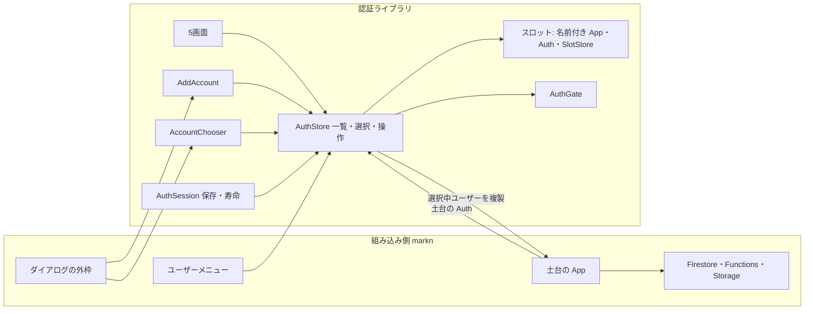
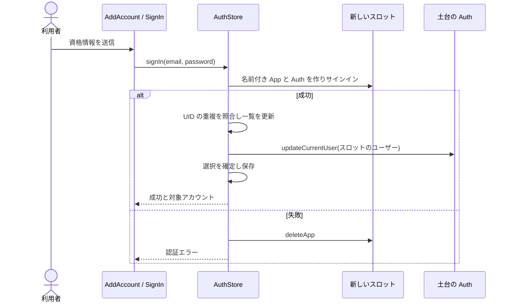
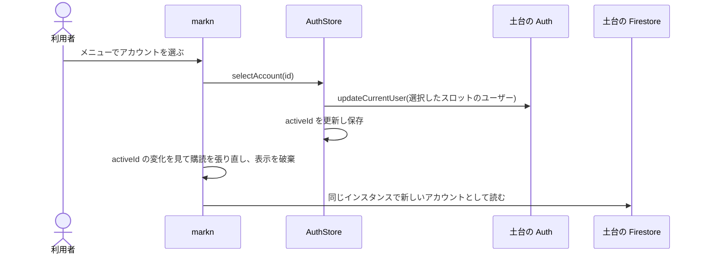
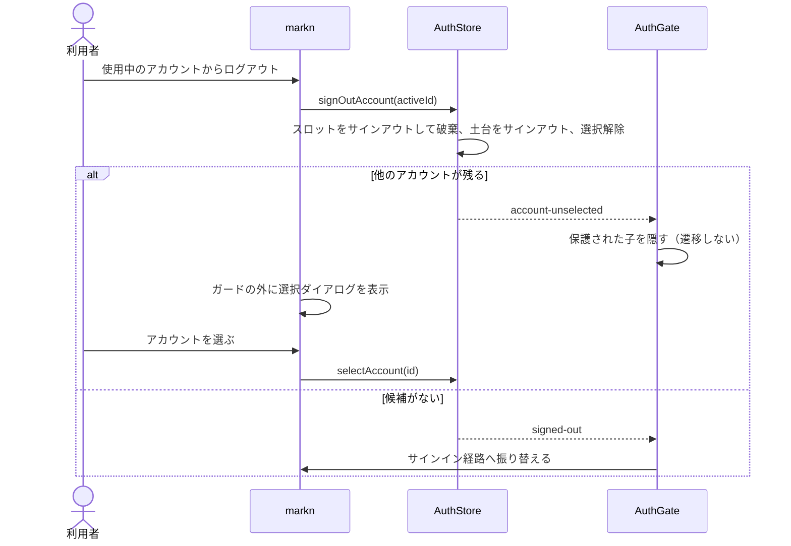

# 技術設計書

## Overview

本機能は、同じアプリケーションで複数の Firebase アカウントのログイン状態を保持し、markn のユーザーメニューから直接切り替えられるようにする。サインインに成功したアカウントは自動で選択する。選択中のアカウントからログアウトして他にログイン済みアカウントがあれば、markn が選択ダイアログを表示する。

構成は「土台の App」と「スロット」の二層からなる。

- **土台の App**: 組み込み側が初期化し、Firestore・Functions・Storage を作る App。その Auth（土台の Auth）を `createAuthStore` に渡す。土台の Auth は、選択中アカウントの複製を入れる席であり、ログイン状態を保存しない。
- **スロット**: アカウント1件のログイン状態を保持する、ライブラリ内部の名前付き App と Auth。ライブラリが土台の App の設定から作る。ログイン状態の保存と復元はスロットが持つ。

選択を変えると、ライブラリは選択したスロットのユーザーを Firebase の公開 API `updateCurrentUser` で土台の Auth へ複製する。土台の App から作った Firestore などは、同じ App の Auth のユーザーで認証するため、作り直さずに選択中アカウントの認証で動く。組み込み側のデータ層は複数アカウントを意識しない。

認証ストアは1つに一本化する。複数アカウントに対応するかどうかは `AuthConfig.multiAccount` で指定する。単一アカウントの指定（`false`）では保持アカウントを最大1件にし、保持アカウントがあれば常にそれを選択中とする。仕組み（スロットと土台への複製）は共通で、違いは保持の上限と選択の決め方だけである。すべてのスロットは対等で、どの画面からのサインインも新しいスロットに入る。最初のサインインと別アカウントの追加は同じ操作である。従来方式で土台の Auth に保存されていたログイン状態は引き継がない。

| 名前        | 役割                                                                                                                           |
| ----------- | ------------------------------------------------------------------------------------------------------------------------------ |
| 土台の Auth | 組み込み側の App に属する Auth。選択中アカウントの複製だけを持つ。メモリのみに置き、タブごとに独立する。                       |
| スロット    | 安定した ID と、ライブラリが作る名前付き App・Auth・`SlotStore` の組。アカウント1件のログイン状態を保存・復元する。            |
| `SlotStore` | 1つのスロットの Auth を扱う内部のストア。現行 `auth.svelte.ts` の処理を移したもの。公開しない。                                |
| `AuthStore` | 公開する唯一の認証ストア。スロットを束ね、一覧・選択・サインイン・ログアウト・選択中アカウントへの操作と、土台への複製を持つ。 |

### Goals

- アカウントの一覧、選択中アカウント、切り替え・ログアウトを、画面に依存しない公開契約として提供する。
- 組み込み側が土台の App から作ったデータアクセスを、作り直しなしに選択中アカウントの認証で動かす。
- 追加ログインの入力をページにもダイアログにも置ける形にし、認証成功時は新しいアカウントへ切り替える。
- 再読み込み、複数タブ、選択中アカウントのログアウトにおいて、保護された内容と選択 UI の表示を正しく制御する。
- 単一アカウントを指定した組み込み先が、アカウント一覧・選択の UI を置かずに同じ部品で使え、未選択の状態に陥らないようにする。

### Non-Goals

- markn のユーザーメニュー、ダイアログの外枠、未保存データの確認、データの購読・表示の切り替え、アクセス制御の実装。
- 異なる Firebase プロジェクトをまたぐアカウント管理、端末間の一覧同期、独自のパスワード・トークン保存。
- 外部認証プロバイダ。後続で加えうるが、この設計ではメールアドレスとパスワードを扱う。

## Boundary Commitments

### This Spec Owns

- スロットの App・Auth の生成と破棄、識別、ログイン済み一覧、選択、土台の Auth への複製、サインイン・登録、対象指定と全件のログアウト、復元時の照合。
- 土台の Auth の保存方法（メモリのみ）と、その中身の管理。
- スロット記録、タブ単位の選択、新しいタブ用の最後に開いたアカウントの保存、および保存不能時の状態通知。
- 未選択を含む到達判定、保護された内容の抑止、選択 UI が使える状態。
- 5画面の新しいストアへの対応、追加ログインの中身のみのコンポーネント、任意利用のアカウント選択内容、日本語・英語の文言、公開型、README、ショーケース。

### Out of Boundary

- 土台の App、Firestore、Functions、Storage の初期化とエミュレータへの接続は組み込み側。
- markn のメニュー・ダイアログの開閉、切り替え時の購読の張り直し・表示データの破棄、未保存データの確認。
- セキュリティルール、サーバー側のセッション検証、Firebase SDK の内部保存キーの操作。

### Allowed Dependencies

- `models/auth` の型・純関数 → `stores/`（`slot.svelte.ts` → `auth.svelte.ts`）→ `components/` の一方向。
- `firebase/app`（スロットの `initializeApp`・`deleteApp`）と `firebase/auth` は既存の peer 依存を使用する。`firebase/firestore`・`firebase/functions`・`firebase/storage` を配布物へ追加しない。
- `$app/*` とブラウザ保存領域への直接アクセスは `components/` に限る。ストアにはブラウザ保存アダプタを渡す。
- UI は既存の `@14ch/svelte-ui` と文言差し替えの仕組みを使う。

### Revalidation Triggers

- `AuthStore`、`AuthGate`、認証経路、公開型または画面 props の変更時は markn の組み込みとテストを再確認する。
- Firebase の保存方法、`updateCurrentUser`、名前付き App の扱いを変えた場合は、複製・復元・別タブの挙動を実ブラウザとエミュレータで再検証する。
- Firebase JS SDK を更新した場合は、土台の Firestore が複製したユーザーに追随することを再検証する。

## Architecture

### Existing Architecture Analysis

現行 `createAuthStore(auth, config)` は1つの Auth を扱い、5画面と `AuthGate` はその `AuthStore` を受け取る。Auth 1つが保持できるログイン状態は1件なので、複数アカウントにはアカウントごとの Auth が要る。一方、Firestore などは同じ App の Auth のユーザーで認証し、別の App の Auth を指定する公開 API は無い。そこで、ログイン状態はスロットの Auth に保持し、選択中の1件だけを土台の Auth へ複製する。現行ストアの処理は1スロット分の処理としてそのまま使えるため、内部の `SlotStore` へ移す。

### Architecture Pattern & Boundary Map

選択したパターンは「スロットに保持し、選択中の1件を土台へ複製する」。組み込み側・画面・到達ガードは公開の `AuthStore` と、自分の土台の App だけに触れる。スロットの App・Auth・`SlotStore` はストアの内部に閉じる。



#### 土台の Auth の扱い

- `getAuth(app)` で作った Auth は、Firebase の既定でログイン状態をブラウザ（IndexedDB）に保存する。ストアは開始時に `setPersistence(土台の Auth, inMemoryPersistence)` でメモリのみに切り替える。組み込み側に `initializeAuth` での指定を求めないのは、書き忘れても動いてしまい、タブ間の独立が黙って崩れるためである。
- 土台の Auth の中身は、開始時も含めて常に「選択中スロットのユーザーの複製、未選択なら空」の規則だけで決まる。開始時もタブの選択を照合し、複製するか空にする。
- メモリのみのため、Firebase のタブ間同期の対象にならず、タブごとに独立する（検証済み）。再読み込みのたびに空から始まり、ストアがタブの選択に従って複製し直す。
- 土台の Auth の中身を変えるのはストアだけである。複製は常にスロット → 土台の一方向で、土台からスロットへ戻さない。組み込み側は土台の Auth でサインイン・サインアウトしない（手引きに明記する）。
- 未選択のときは土台の Auth をサインアウトする。サインアウトはリフレッシュトークンを失効させないため、スロットのログイン状態は残る（検証済み）。

#### スロットの App と Auth

- ストアはスロット ID を生成し、`initializeApp(土台の App の options, 'svelte-firebase-auth/<スロット ID>')` で名前付き App を作る。スロット ID は生成した時刻（36 進数・桁を揃える）と乱数の組で、ID の順が作った順になる。同じミリ秒に2件作っても順が崩れないよう、同じストアの中では時刻を単調に進める。App 名はスロット ID から一意に決まる。Firebase のログイン状態の保存キーは App 名を含むため、同じ ID で作り直せば再読み込み後に復元される。
- スロットの Auth は Firebase の既定のブラウザ保存を使う。タブ間で共有され、別タブでのサインイン・ログアウトも同期される（検証済み）。
- 土台の Auth がエミュレータに接続されていれば（`emulatorConfig`）、スロットの Auth も同じ接続先へつなぐ。組み込み側は `createAuthStore` に渡す前に土台の Auth をエミュレータへ接続しておく。
- スロットの App はデータアクセスに使われないため、ログアウト・サインインの失敗・取消・重複で不要になった時点で `deleteApp` で破棄する。

#### データアクセス

markn は従来どおり土台の App から `getFirestore(app)`、地域を指定した `getFunctions(app, region)`、必要なら `getStorage(app, bucket)` を一度だけ作る。選択を変えると、同じインスタンスのまま新しいアカウントの認証で動く（Firestore で検証済み）。ただし、切り替え元のアカウントで張った購読や画面に出しているデータは、別のアカウントのものとして残る。markn は選択の変化（`store.activeId` の変化）を見て、購読を張り直し、表示データを破棄する。

### Technology Stack

| Layer           | Choice / Version                                  | Role in Feature                              | Notes                                                           |
| --------------- | ------------------------------------------------- | -------------------------------------------- | --------------------------------------------------------------- |
| UI              | Svelte 5、SvelteKit 2、`@14ch/svelte-ui`          | 状態表示、追加ログイン、到達制御             | 既存 peer 依存を使用                                            |
| Auth            | Firebase JS SDK 12 系（ローカルでは 12.19.0）     | スロットのログイン状態と永続化、土台への複製 | `updateCurrentUser`・`inMemoryPersistence` を使用。新規依存なし |
| Browser storage | `localStorage` と `sessionStorage`                | スロット記録、タブ選択、最後に開いた ID      | 保存失敗時はメモリ利用へ縮退                                    |
| Testing         | Vitest、Auth / Firestore エミュレータ、Playwright | 状態遷移、複製の追随、複数タブの実動作       | Firestore エミュレータは検証用のみ                              |

## File Structure Plan

### Directory Structure

```text
src/lib/
├── models/auth/
│   ├── auth.types.ts          # 公開型（AuthStore、AccountSummary、結果型、段階）と保存の契約
│   ├── slots.ts               # スロット記録の検証と一覧の照合（純関数）
│   └── authGuard.ts           # 未選択を含む到達判定
├── stores/
│   ├── slot.svelte.ts         # 1つのスロットを扱う SlotStore（現行 auth.svelte.ts から移す）
│   └── auth.svelte.ts         # スロットを束ね、土台へ複製する公開の AuthStore
└── components/
    ├── AuthSession.svelte     # ブラウザ保存と別タブ通知、ストアの開始・停止
    ├── AddAccount.svelte      # 追加ログイン・登録・再設定の中身
    └── AccountChooser.svelte  # 任意利用のアカウント選択・個別/全件ログアウトの中身
```

### Modified Files

- `src/lib/stores/auth.svelte.ts` — `createAuthStore(auth, config)` のシグネチャは保ち、中身をスロットを束ねる公開ストアに置き換える。現行の1 Auth 分の処理は `slot.svelte.ts` へ移す。
- `src/lib/models/auth/auth.types.ts` — `AuthStore` を一本化したストアの契約に改める。`AuthStage` に `account-unselected`、`AuthGuardDecision` に `select`、`AuthConfig` に必須の `multiAccount` を加える。
- `src/lib/models/auth/authGuard.ts` — `account-unselected` の判定を加える。
- `src/lib/components/AuthGate.svelte` — `select` の判定で、遷移せず子を描画せず戻り先を保持する。
- `src/lib/components/SignIn.svelte`・`SignUp.svelte` — `signIn`・`signUp` の新しい結果型に合わせる。
- `src/lib/components/VerifyEmail.svelte`・`PasswordChange.svelte` — 選択中アカウントが変わったら画面の途中状態を破棄する（要件 7.18）。`VerifyEmail` の `signOut` は選択中アカウントのログアウトになる。
- `src/lib/messages/ja.ts`、`en.ts`、`resolveMessages.ts` — 追加・選択の文言と差し替え。`accountErrorMessageOf`（`accountErrorMessage.ts`）でアカウントの操作の失敗を文言へ写す。組み込み独自のメニューでも同じ案内を出せるよう公開する。
- `src/lib/index.ts` — `AuthSession`、`AddAccount`、`AccountChooser`、`accountErrorMessageOf` と対応する型を公開する。保存の契約（`AccountPersistence`・`StoredSlot`・`StorageResult`）と内部のスロット（`SlotStore`・`Slot`・照合の型と純関数）は公開しない。
- `src/routes/` — ショーケースを新しいストアへ移し、ユーザーメニューを模した入口とガードの外に置く選択 UI を加える。
- `src/tests/` — ストア、保存、エミュレータ、ショーケースの要件別検証。既存テストを新しいストアへ移す。エミュレータの検証に Firestore を加える（開発時のみ）。
- `firebase.json`・`package.json` — 検証用に Firestore エミュレータとルールを加える。
- `README.md` — 新しい組み込み手順（`AuthSession`、土台の Auth をストアに委ねること、切り替え時の購読の張り直し、保存不能時の扱い）に書き直す。

## System Flows

### サインイン（最初のサインインと追加ログインは同じ流れ）



### 切り替え



### 選択中アカウントのログアウト



## Requirements Traceability

| Requirement                                 | Summary                  | Components                                                     | Interfaces                                             | Flows            |
| ------------------------------------------- | ------------------------ | -------------------------------------------------------------- | ------------------------------------------------------ | ---------------- |
| 1.1, 1.2, 1.3, 1.4, 1.5                     | 複数の保持と一覧         | AuthStore、AccountChooser                                      | AccountSummary、accounts、activeId                     | 復元・一覧       |
| 2.1, 2.2, 2.3, 2.4, 2.5, 2.6, 2.7, 2.8      | 追加・重複・登録・再設定 | AuthStore、AddAccount、SignIn、SignUp                          | signIn、signUp、cancelPendingSignIn、sendPasswordReset | サインイン       |
| 3.1, 3.2, 3.3, 3.4, 3.5, 3.6, 3.7           | 切り替えと競合           | AuthStore、SlotStore、VerifyEmail、PasswordChange              | selectAccount、user、operation                         | 切り替え         |
| 4.1–4.12, 4.14, 4.15                        | 復元・保存・別タブ       | AuthSession、AuthStore                                         | AccountPersistence、isResolved、storageStatus          | 復元・別タブ通知 |
| 5.1, 5.2, 5.3, 5.4, 5.5, 5.6, 5.7, 5.8, 5.9 | 個別・全件ログアウト     | AuthStore、AccountChooser、VerifyEmail                         | signOut、signOutAccount、signOutAll                    | ログアウト       |
| 6.1, 6.2, 6.3, 6.4, 6.5, 6.6, 6.7, 6.8, 6.9 | 未選択と到達制御         | AuthGate、authGuard、AuthStore                                 | AuthStage、AuthGuardDecision                           | ログアウト・復帰 |
| 7.1–7.21                                    | 公開面・UI・組み込み     | index、5画面、AddAccount、AccountChooser、README、ショーケース | AuthStore、コンポーネント props                        | 切り替え         |

要件 4.13 は欠番（従来方式からの引き継ぎを行わない）。

## Components and Interfaces

| Component            | Domain/Layer        | Intent                                           | Req Coverage     | Dependencies                                           |
| -------------------- | ------------------- | ------------------------------------------------ | ---------------- | ------------------------------------------------------ |
| AuthStore            | stores              | スロットの管理、選択、土台への複製の唯一の担い手 | 1、2、3、4、5、7 | 土台の Auth（P0）、SlotStore（P0）、保存アダプタ（P0） |
| SlotStore            | stores（内部）      | 1つのスロットのログイン状態と操作                | 2、3、5          | Firebase Auth（P0）                                    |
| AuthSession          | components          | ブラウザ保存とタブ通知を管理する描画なしの部品   | 4、7             | AuthStore（P0）、Web Storage（P0）                     |
| 5画面                | components          | サインイン・登録・確認待ち・変更・再設定         | 2、3、5、7       | AuthStore（P0）、svelte-ui（P1）                       |
| AddAccount           | components          | 追加認証の中身を表示する                         | 2、7             | AuthStore（P0）、svelte-ui（P1）                       |
| AccountChooser       | components          | 任意利用の選択・ログアウト内容                   | 1、5、6、7       | AuthStore（P0）、svelte-ui（P1）                       |
| AuthGate / authGuard | components / models | 未選択を含む到達判定と保護内容の抑止             | 6                | AuthStore（P0）、SvelteKit（P0）                       |

### ストア

#### AuthStore

**Responsibilities & Constraints**

- 各スロットの App・Auth・`SlotStore` を対応づけ、一覧と選択中の1件を公開する。`uid` で重複を判定する。表示するメールアドレスは既存の `normalizeEmail` を用いる。
- **土台の Auth は常に選択中スロットのユーザーの複製であり、未選択なら空である。** 選択・サインイン成功・選択中アカウントへの操作の完了ごとに `updateCurrentUser` で複製し直す。`activeId` は複製が済んでから更新し、`activeId` と土台の Auth が別のアカウントを指す状態を公開しない。
- **土台を更新する処理は、すべて1本の待ち行列で直列に実行する。** `updateCurrentUser` も土台のサインアウトも非同期であり、並行すると完了の順で土台の中身が決まってしまう。
  - ストアは公開する `activeId` とは別に、内部で「目標の選択」を持つ。切り替え・サインイン成功・ログアウト・失効は、まず目標を書き換えてから土台の更新を待ち行列へ積む。
  - 待ち行列の各処理は対象を持ち越さない。実行する時点で目標を読み、目標のスロットがまだ保持されていればその複製に、目標が無ければ空にする。完了時に目標が変わっていなければ `activeId` を目標に合わせて公開し、変わっていれば公開せず次の処理に任せる。
  - **失敗・取消では、その操作が設定した目標を取り消す。** 切り替え・サインインは、目標を書き換える前の値を控えておく。複製の失敗や取消で操作が失敗に終わったら、目標がまだその操作の設定した値のときに限り、控えた値へ戻して土台の更新を積み直す。目標が別の値に変わっていれば（後から届いたログアウト・失効・別の切り替え）、戻さずにそちらを優先する。失敗として返した操作が、後から別の処理によって実行されることはない（要件 2.4、2.5、3.4、7.12）。
  - 目標が変わらない再複製（操作の完了後の複製し直し）が失敗した場合、土台には同じアカウントの以前の複製が残り、`activeId` との食い違いは生じない。次の再複製で回復する。
  - これにより、A の確認状態の取り直しが B への切り替え中に完了しても、その後の複製は目標の B を読むため、A が土台へ戻ることはない（要件 3.2、3.6）。
  - 追加・選択・ログアウトの受付の直列化（`busy`）は利用者の操作の重複を防ぐためのもので、土台の整合はこの待ち行列が保つ。
- 開始時は土台の Auth をメモリのみにし、保存されたスロットを復元する。各スロットの初回判定が済み、タブの選択を照合して土台を複製または空にし終えるまで `isResolved=false` とする。保存記録だけでログイン済みと判定しない。タブ内に選択記録がなければブラウザ共通の最後に開いたアカウントを初期候補にする。認証状態を失ったスロットは一覧から外し、選択中なら未選択にする。
- `signIn`・`signUp` は、どの画面から呼ばれても新しいスロットで認証する。成功したら一覧を確定し、土台へ複製してから選択し、明示的な未選択を上書きして最後に開いた ID を保存する。失敗・取消ではスロットを破棄し、元の選択を保つ。
  - 認証に成功した後で土台への複製だけが失敗した場合は、そのアカウントを一覧に残し（ログイン状態は実際に保持している）、選択は元に戻して失敗を返す。利用者は一覧から選び直せる（実装時の判断）。
- 同じタブでのサインインの意図は `signIn`・`signUp` の呼び出しそのものが示す。別タブで追加されたスロットは一覧へ加えるだけで、現在のタブの選択を変えない。
- ログアウトは、どの経路（`signOut`・`signOutAccount`・`signOutAll`・別タブ・失効）で観測しても同じ状態更新を行う。該当アカウントを一覧から外してスロットを破棄し、選択中なら土台をサインアウトして明示的な未選択を保存し、最後に開いた ID が一致すれば消す。他のアカウントを自動選択しない。
- 追加・選択・ログアウトは同時に1件だけ受け付け、競合は `busy` で返す。
- **単一アカウント指定（`multiAccount: false`）では保持アカウントを最大1件にする。**
  - 保持アカウントがあれば、それを常に選択中とする。タブ内の選択記録と最後に開いた ID は参照しない。選択中アカウントを失えば `signed-out` になり、`account-unselected` は現れない。
  - 保持アカウントがあるのに選択が無いのは、残すアカウントへ複製し終えるまでの間（別タブとの競合の解消中など）だけである。この間の段階は `unresolved` とし、到達ガードに判定待ちを出させる。`signed-out` にするとサインインへ振り替えられてしまう（実装時の判断）。
  - 保持アカウントがある間の `signIn`・`signUp` は `limit-reached` で拒否し、既存のログイン状態を変えない（要件 7.19）。到達ガードはこの状態でサインイン・登録の経路を開かせないため、ライブラリの画面からは起きない。
  - 別タブとの競合で2件になった場合は、後からサインインしたアカウント（`metadata.lastSignInTime` が新しい方）を残し、他方のスロットをサインアウトする（要件 7.20）。
  - `selectAccount`・`signOutAccount`・`signOutAll` はそのまま使える。1件しかないため、`signOutAll` は `signOut` と同じ結果になる。
- サインインの送信中に取りやめても Firebase の進行中の要求は中断できないため、その試行を無効として扱う。後から成功が返った場合はそのスロットをサインアウトして破棄し、一覧と選択へ反映しない。
- `changePassword`・`sendEmailVerification`・`refreshVerification` は、呼び出し時点の選択中**スロット**のユーザーに対して行う。土台の複製に対しては行わない。完了後は土台の更新を待ち行列へ積む（`refreshVerification` は確認済みと分かったときだけ積む。確認待ちの画面は数秒ごとに取り直すため、毎回複製し直すと `user` が無用に置き換わり続ける。複製し直す目的は、確認済みのクレームを土台のデータアクセスへ届けることにある）。実行時点の目標がそのスロットなら複製し直され、別のスロットなら目標の側が複製される。本番の Firebase はパスワード変更で他の場所のリフレッシュトークンを失効させるため、複製し直さないと土台の複製が使えなくなる（エミュレータは失効させないため、本番での確認は未実施）。完了までに選択が変わっていれば、結果は開始時のスロットにだけ反映し、土台には触れない。
- 対象指定ログアウトはそのスロットの Auth に直接行い、Firebase の失敗を握りつぶさない。全件ログアウトは成功したスロットだけを除き、失敗したスロットと理由を返す。
- `stop()` は購読を解除しスロットの App を破棄する。ログアウトはしない。画面が閉じただけでログイン状態を失わせない。

**Dependencies**: Inbound — 5画面、AddAccount、AccountChooser、markn メニュー、AuthGate、AuthSession（P0）。Outbound — 土台の Auth、SlotStore、保存アダプタ（P0）。

**Contracts**: Service ✓ / State ✓

```typescript
type AuthStage =
	| 'unresolved'
	| 'signed-out' // 保持アカウントが無い
	| 'account-unselected' // 保持アカウントはあるが選択が無い
	| 'email-unverified'
	| 'ready';

interface AccountSummary {
	readonly id: string; // メールアドレスや UID ではなく、安定したスロット ID
	readonly uid: string;
	readonly email: string | null;
	readonly isEmailVerified: boolean;
}

type AccountOperationError =
	| { readonly kind: 'auth'; readonly cause: AuthError }
	| { readonly kind: 'not-found' | 'not-signed-in' | 'busy' | 'cancelled' | 'limit-reached' }
	| { readonly kind: 'initialization'; readonly detail: string };

type AccountResult<T> =
	| { readonly ok: true; readonly value: T }
	| { readonly ok: false; readonly error: AccountOperationError };

interface AccountFailure {
	readonly id: string;
	readonly error: AccountOperationError;
}

type SignOutAllResult =
	| { readonly ok: true; readonly signedOutIds: readonly string[] }
	| {
			readonly ok: false;
			readonly reason: 'partial';
			readonly signedOutIds: readonly string[];
			readonly failed: readonly AccountFailure[];
	  }
	| { readonly ok: false; readonly reason: 'busy'; readonly signedOutIds: readonly string[] };

interface AuthStore {
	// 一覧と選択
	readonly accounts: readonly AccountSummary[];
	readonly activeId: string | null;
	readonly activeAccount: AccountSummary | null;

	// 選択中アカウントの状態（未選択なら null / false）。user は土台の Auth の複製
	readonly user: User | null;
	readonly isLoggedIn: boolean;
	readonly email: string | null;
	readonly isEmailVerified: boolean;

	readonly isResolved: boolean;
	readonly startError: AccountOperationError | null; // 続行できない開始失敗。null 以外なら isResolved は false のまま
	readonly restoreFailures: readonly AccountFailure[]; // 開始時に復元できなかったスロット
	readonly stage: AuthStage;
	readonly storageStatus: 'available' | 'unavailable';
	readonly operation: {
		readonly kind: 'sign-in' | 'select' | 'sign-out';
		readonly id?: string;
	} | null;
	readonly canSelfRegister: boolean;
	readonly requiresEmailVerification: boolean;
	readonly routes: AuthRoutes;

	// アカウントの出入りと選択
	signIn(email: string, password: string): Promise<AccountResult<AccountSummary>>;
	signUp(email: string, password: string): Promise<AccountResult<AccountSummary>>;
	cancelPendingSignIn(): void;
	selectAccount(id: string): Promise<AccountResult<AccountSummary>>;
	signOut(): Promise<AccountResult<{ readonly id: string }>>; // 選択中アカウントのログアウト
	signOutAccount(id: string): Promise<AccountResult<{ readonly id: string }>>;
	signOutAll(): Promise<SignOutAllResult>;

	// 選択中アカウントへの操作（呼び出し時点のスロットに固定）
	changePassword(currentPassword: string, nextPassword: string): Promise<AuthResult>;
	sendEmailVerification(): Promise<AuthResult>;
	refreshVerification(): Promise<boolean>;

	// アカウントに依らない操作
	sendPasswordReset(email: string): Promise<AuthResult>;

	start(persistence: AccountPersistence): Promise<void>;
	stop(): void;
}

// auth は組み込み側の土台の App の Auth。渡した後の中身はストアが管理する
declare function createAuthStore(auth: Auth, config: AuthConfig): AuthStore;

interface AuthConfig {
	// 既存の項目（selfRegistration・emailVerification・continueUrl・routes）に加える
	readonly multiAccount: boolean; // false なら保持アカウントを最大1件にする
}
```

`user`・`activeAccount`・`activeId` は同じ状態更新で公開し、互いに異なるアカウントを指す瞬間を作らない。`user` は土台の Auth の `currentUser` であり、`updateCurrentUser` は複製した新しいオブジェクトを入れるため、**同じアカウントのままでも複製し直すたびに別のオブジェクトになる**（パスワード変更・確認状態の取り直しのあと）。アカウントが変わったかどうかは `activeId` または `activeAccount.uid` で判定し、`user` のオブジェクトの同一性で判定しない。`signOutAll` は全件成功なら成功した ID を返し、一部失敗なら成功分を反映したうえで失敗した ID と理由を返す。保存不能ならメモリで開始して `storageStatus` に示す。

**開始時の失敗**は、続行できるかどうかで2つに分ける。

| 失敗                                          | 扱い                                                                                                                                                                                                                                                                         |
| --------------------------------------------- | ---------------------------------------------------------------------------------------------------------------------------------------------------------------------------------------------------------------------------------------------------------------------------- |
| 土台の Auth をメモリのみに切り替えられない    | 続行しない。タブ間の独立を保証できないため。`startError` に `initialization` を入れ、`isResolved=false`・`stage='unresolved'` のまま止める。到達ガードは保護された内容を出さない（`pending` を出す）。組み込み側は `startError` を見て案内を出す。再試行は再読み込みで行う。 |
| 一部のスロットの App 生成・初回判定に失敗した | 複数アカウント指定では続行する（単一アカウント指定は下記）。そのスロットは一覧に入れず、`restoreFailures` に ID と理由を入れる。スロット記録は消さず、次回の開始で再び試す。失敗したスロットが選択対象だった場合は、選択を復元できなかった場合として扱う（要件 4.3）。       |

土台への複製に失敗した場合も、選択を復元できなかった場合として扱う。

**単一アカウント指定では、スロットの復元の失敗と開始時の複製の失敗も続行しない。** 選択を復元できなかった場合として扱うと、保持アカウントがあるのに未選択になるか、復元できなかったアカウントを残したまま別のサインインを受け付けることになる。単一アカウント指定は選択の UI を持たず、保持中のサインインも拒否するため、どちらも行き詰まる。`startError` に入れ、土台の切り替えの失敗と同じく判定待ちのまま止めて再読み込みを促す（要件 4.4、7.1、7.19）。

`startError` が入った場合を除き、開始の処理が終われば `isResolved=true` になる。重複 UID のサインインでは既に保持しているスロットを選択し、新しいスロットをサインアウトして破棄する。スロットの App の生成に失敗した場合は `initialization` として返し、選択を変えない。

#### SlotStore（内部）

- 現行 `createAuthStore(auth, config)` の処理を移す。`onAuthStateChanged` の購読、サインイン・登録・パスワード変更・確認メール・確認状態の取り直しを1つのスロットの Auth に対して行う。
- `signOut` は失敗を握りつぶさず `AuthResult` を返す。
- `index.ts` から公開しない。画面も組み込み側も触れない。

### ブラウザ保存

#### AuthSession

**Responsibilities & Constraints**

- 描画を持たず、ブラウザでのマウント時にストアを開始し、アンマウント時に停止する。ブラウザ保存への直接アクセスをこのコンポーネントに閉じる。組み込み側は根の配置に1つ置く。単一アカウントの組み込み先でも同じく置く。
- `localStorage` に名前空間付きのスロット記録を1件ずつ保持し、最後に開いたアカウントのスロット ID も別キーで保持する。スロット記録はスキーマ版、スロット ID、期待する UID のみ。メールアドレス、パスワード、トークンは独自保存しない。
- キーは `svelte-firebase-auth:<namespace>:slot:<スロット ID>`（スロット記録）、`svelte-firebase-auth:<namespace>:last-opened`（最後に開いたアカウント）、`svelte-firebase-auth:<namespace>:active`（タブの選択。JSON で ID か `null`）とする。
- 開始と停止は、ストアか名前空間が替わったときだけやり直す。開始の処理が読む状態を、効果の依存として拾わない（拾うと開始し直しが繰り返される）。
- `sessionStorage` に現在のタブの選択中スロット ID を保持する。記録なしと明示的な未選択を区別し、後者は `null` として保存する。新しいタブが元タブの有効な ID を初期コピーした場合はそれを優先し、記録がなければ `localStorage` の最後に開いたアカウントを初期候補にする。`null` が初期コピーされた場合は未選択を維持し、最後に開いた ID へのフォールバックは行わない。選択後はタブごとに独立し、別タブでの選択変更によって現在のタブの選択を変えない。
- 明示的な選択、サインイン・登録の成功、タブの復元で有効なアカウントを開いたときに最後に開いた ID を更新する。最後に開いた ID が無効なら新しいタブでは選択を求める。
- タブ内の選択記録と最後に開いた ID は、複数アカウント指定のときだけ使う。単一アカウント指定でもスロット記録は保存する。
- 別タブからの `localStorage` 変更はスロット記録を再読込し、スロットの Auth の購読結果と照合する。最後に開いた ID の変更では現在のタブの選択を変えない。スロットごとのキーで書き込み競合を避ける。別タブで同じ UID のスロットが同時にできた場合は、ID の順序で代表を決める。選択が重複側を指していれば代表側へ対応づけてから重複を解消する。保存領域が使えない場合はメモリで続け、復元不能を公開する。

**Dependencies**: Inbound — 組み込み側の根レイアウト（P0）。Outbound — AuthStore、`localStorage`、`sessionStorage`（P0）。

**Contracts**: Service ✓ / State ✓

```typescript
interface StoredSlot {
	readonly version: 1;
	readonly id: string;
	readonly uid: string;
}

interface AccountPersistence {
	readSlots(): StorageResult<readonly StoredSlot[]>;
	writeSlot(slot: StoredSlot): StorageResult<void>;
	removeSlot(id: string): StorageResult<void>;
	readActiveId(): StorageResult<string | null | undefined>; // undefined はタブ内記録なし、null は明示的な未選択
	writeActiveId(id: string | null): StorageResult<void>;
	readLastOpenedId(): StorageResult<string | null>;
	writeLastOpenedId(id: string | null): StorageResult<void>;
	onSlotsChanged(listener: () => void): () => void;
}

type StorageResult<T> = { readonly ok: true; readonly value: T } | { readonly ok: false };

interface AuthSessionProps {
	readonly store: AuthStore;
	readonly namespace: string;
}
```

保存キーと名前空間は他の組み込み先と衝突させない。保存記録はスロットへの索引であり、認証の真実は各スロットの Auth の状態である。記録に対応する Auth の UID が期待値と異なる場合、そのスロットを一覧に入れない。Auth SDK の内部保存キーには触れない。

### UI と到達制御

#### 5画面

- 受け取る型は従来どおり `AuthBaseProps.store: AuthStore` で、その中身が一本化したストアになる。
- `SignIn`・`SignUp` は `store.signIn`・`store.signUp` を呼ぶ。新しいスロットに入るため、他の保持アカウントのログイン状態を上書きしない。結果の失敗は `accountErrorMessageOf` で文言へ写す。`error.kind === 'auth'` は既存の文言へ、`busy`・`limit-reached`・`not-found`・`not-signed-in` はそれぞれ専用の文言へ、それ以外は汎用の失敗文言へ写す。当初は認証以外をすべて汎用の文言にする想定だったが、`AddAccount`・`AccountChooser` と写像を共用し、処理中・上限を利用者が区別できるようにした（実装時の判断）。
- `VerifyEmail`・`PasswordChange` は選択中アカウントに適用する。表示中に `store.activeId` が変わったら、入力・送信結果・完了表示を破棄して表示し直す（要件 7.18）。画面の内容を `activeId` で鍵付けして作り直す形で実装し、組み込み側に `{#key}` を書かせない。
- 作り直しだけでは、破棄した画面で走っていた非同期処理（送信・確認状態の定期的な取り直し）の完了は止まらない。画面は処理の開始時に `activeId` を控え、完了時に「画面が破棄されている」か「`activeId` が控えた値と異なる」なら、表示の更新も `onCompleted` の呼び出しも行わない。定期的な取り直しは画面の破棄で止める（要件 3.6、7.18）。
- `VerifyEmail` のサインアウトは `store.signOut()`（選択中アカウントのログアウト）になる。

#### AddAccount

**Responsibilities & Constraints**

- メールアドレスとパスワードの入力、送信中表示、既存のエラー語彙に対応した案内を行う。ダイアログの外枠、見出し、開閉は持たない。
- 自由登録が許される場合は登録の入力へ、パスワード再設定を求める場合は再設定の入力へ、同じ内容領域内で切り替える。成功時はアカウントを含む通知を組み込み側へ返し、閉じるかどうかは組み込み側が決める。
- 認証操作はストアへ委譲する。`SignIn` と同じ `store.signIn` を使い、`SignIn` のページ遷移は使わない。
- 取消時は `cancelPendingSignIn()` を呼んで進行中の試行を無効化し、`onCancel` で組み込み側へ通知する。

**Dependencies**: Inbound — markn のダイアログまたはアプリのページ（P0）。Outbound — AuthStore、文言解決、svelte-ui（P0/P1）。

**Contracts**: State ✓

```typescript
interface AddAccountProps {
	readonly store: AuthStore;
	readonly messages?: AuthMessagesOverride;
	readonly onCompleted?: (account: AccountSummary) => void;
	readonly onCancel?: () => void;
}
```

#### AccountChooser

**Responsibilities & Constraints**

- アカウントの一覧、選択中表示、直接切り替え、個別・全件ログアウト、追加要求を表す中身のみの任意コンポーネント。markn は同じストアを使って独自メニューと選択ダイアログを実装してよい。
- キーボード操作可能な svelte-ui 部品を使い、選択中かどうかをテキストまたはアクセシブルな状態でも伝える。操作中は競合する入力を止め、失敗時は対象が分かる案内を表示する。
- `storageStatus='unavailable'` の場合は再読み込み後にログイン状態や選択を復元できない可能性を示す。

**Dependencies**: Inbound — アプリのページまたはダイアログ（P0）。Outbound — AuthStore、svelte-ui、文言解決（P0/P1）。

**Contracts**: State ✓

```typescript
interface AccountChooserProps {
	readonly store: AuthStore;
	readonly messages?: AuthMessagesOverride;
	readonly onAddRequested?: () => void;
}
```

#### AuthGate と authGuard

**Responsibilities & Constraints**

- `resolveAuthGuard` は段階・現在の経路・経路設定・保持している戻り先だけから判定する純関数のまま保つ。`account-unselected` の判定と、判定結果 `select` を加える。
- 選択ダイアログや `AccountChooser` は、ガードの子ではなく根レイアウトでガードと並ぶ位置に置く。保護された子が隠れていても操作できる。

**到達判定の表**

| 段階                 | サインイン・登録・再設定   | 確認待ち                               | 保護された経路                                   |
| -------------------- | -------------------------- | -------------------------------------- | ------------------------------------------------ |
| `unresolved`         | `wait`                     | `wait`                                 | `wait`                                           |
| `signed-out`         | `allow`                    | サインインへ振り替え（戻り先は保持分） | サインインへ振り替え（現在の経路を戻り先に保持） |
| `account-unselected` | `allow`                    | `select`（戻り先は保持分）             | `select`（現在の経路を戻り先に保持）             |
| `email-unverified`   | 確認待ちへ振り替え         | `allow`                                | 確認待ちへ振り替え（保持分を維持）               |
| `ready`              | 戻り先または既定へ振り替え | 戻り先または既定へ振り替え             | `allow`                                          |

- `account-unselected` は複数アカウント指定のときだけ現れる。単一アカウント指定では保持アカウントがあれば常に選択中のため、この段階に入らず、選択の UI が無くても行き詰まらない。
- `account-unselected` でサインイン・登録・再設定を許すのは、サインインが常に新しいスロットに入り、他の保持アカウントを上書きしないためである。ここでサインインすればそのアカウントが選択され、`ready` になって戻り先へ進む（要件 6.1、6.7）。
- `select` は遷移せず、子を描画しない（`pending` も出さない）。戻り先を保持する。選択後に `ready` になれば、同じ経路でそのまま子を描画する。
- 選択後に保護された経路へ留まった場合、保持した戻り先は次の振り替えで上書きされるまで残る。使われるのは `ready` で認証経路を開いたときだけで、行き先は直前まで居た保護された経路であるため害はない。
- `email-unverified` は選択中アカウントだけで決まり、他のアカウントの確認状態を使わない（要件 6.8）。確認待ちの経路でも、ガードの外の選択 UI と `AddAccount` から別のアカウントへ切り替え・追加できる（要件 6.5）。
- ページに置いた `AddAccount` は保護された経路の子であるため、`account-unselected` の間は隠れる。この間の追加は、ガードの外に置いた選択 UI・ダイアログか、サインイン経路から行う。
- 選択ダイアログをモーダルで出す組み込み先は、サインイン・登録・再設定の経路では出さない。出すとその経路のサインインの入力を塞ぐ（ショーケースはこの形にしている）。

**Dependencies**: Inbound — 組み込み側の根レイアウト（P0）。Outbound — 純粋なガード判定、SvelteKit の経路・遷移（P0）。

**Contracts**: Service ✓ / State ✓

```typescript
type AuthGuardDecision =
	| { readonly kind: 'wait' }
	| { readonly kind: 'allow' }
	| { readonly kind: 'select'; readonly returnTo: string | null }
	| { readonly kind: 'redirect'; readonly to: string; readonly returnTo: string | null };
```

`AuthGateProps.store` の型は `AuthStore` のまま（中身が一本化したストアになる）。

## Data Models

### Domain Model

- **土台の Auth**: 組み込み側の App に属し、選択中スロットのユーザーの複製を持つ席。メモリのみで、タブごとに独立する。真実の出所ではない。
- **スロット**: ライブラリが作る名前付き App・Auth と `SlotStore` を結ぶ安定した ID。ログイン状態の真実の出所。すべて対等であり、特別扱いするスロットは無い。
- **保持アカウント**: スロットの Auth が解決済みかつ `currentUser` を持つもの。UID が同じスロットは一覧上1件に正規化する。
- **選択**: 現在のタブで最大1件のスロット ID。候補があっても `null` になり得る。ログイン状態ではない。
- **操作**: 追加・切り替え・ログアウトの対象と実行中状態。対象 ID を開始時に固定し、完了後の結果が別アカウントへ流れないようにする。

### Logical Data Model

スロット記録は `version`、`id`、`uid` のみを持つ。タブの選択 ID とブラウザ共通の最後に開いた ID は別に保持する。復元は、土台の Auth をメモリのみにする → 記録 → 同じ ID のスロット App・Auth 生成 → 初回判定 → UID の照合 → 一覧更新 → タブ内選択の照合 → 土台を複製または空にする、の順に進む。タブ内記録がない場合に限り最後に開いた ID を照合し、明示的な未選択は維持する。スロット記録が1件も無ければ `signed-out` である。無効な記録や認証状態のないスロットはログイン済みとして見せない。異なるタブからの変更は、スロットの Auth の状態と保存記録の双方を再照合する。

## Error Handling

- 資格情報、登録、再設定の失敗は既存 `AuthError` と既定文言へ写し、入力を保持する。
- 存在しない・失効したスロットの選択は `not-found` または `not-signed-in` を返し、現在の選択を維持する。
- 土台への複製に失敗した場合は選択を変えずに失敗を返す。土台の Auth と `activeId` を食い違わせない。
- 操作中の重複要求は `busy` を返す。UI も送信・切り替え・ログアウトを無効化する。取り消したサインインは `cancelled` を返す。
- 保存失敗は `storageStatus='unavailable'` として示す。現在のタブでは操作を継続し、再読み込み後の復元は保証しない。
- ログアウト失敗は対象 ID と共に返す。全件ログアウトでは成功した分を維持し、失敗した分だけ再試行できる。
- スロットの App の生成失敗は `initialization` として返し、選択中のアカウントを変更しない。開始時の失敗は「開始時の失敗」の表に従い、`startError`・`restoreFailures` で示す。組み込み側で記録できる詳細を残し、利用者へ Firebase の生のエラーコードを見せない。

## Testing Strategy

テストは requirements.md の受け入れ基準から引き、各テストに要件番号を書く。

- **Unit**: 要件 1–5 の一覧重複、選択の原子性、対象固定、競合、個別・全件ログアウトの部分成功、保存記録の検証。要件 4.11–4.12 はタブ内選択の初期コピー、記録なしからの最後に開いた ID の採用、コピーされた明示的な未選択、無効な ID の4ケース。要件 4.14・5.9 は、どの画面から行ったサインイン・ログアウトも同じ状態更新になること。到達判定は上の表の全セルを `resolveAuthGuard` で確認する。土台の更新の待ち行列は、確認状態の取り直し・パスワード変更の完了と切り替えが交差する順序（完了が切り替えの前・途中・後）で、土台と `activeId` が常に切り替え先に揃うことを確認する（要件 3.2、3.6）。開始時の失敗は、土台の切り替えの失敗で `startError` が入り判定待ちのまま止まること、複数アカウント指定で一部のスロットの失敗が `restoreFailures` に入り他のアカウントは使えること、単一アカウント指定でスロットの復元・複製の失敗が `startError` になり未選択へ進まないことを確認する（要件 4.4、7.1、7.5）。切り替えの複製が失敗したら目標が元に戻り、その後の再複製が失敗した切り替えを実行しないこと、その間に届いたログアウトの目標は戻されないことを確認する（要件 3.4、7.12）。単一アカウント指定では、保持アカウントがある間のサインインが `limit-reached` になること（要件 7.19）、2件になったら後からサインインした方だけが残ること（要件 7.20）、選択中アカウントを失うと `signed-out` になることを確認する。
- **Integration（Auth / Firestore エミュレータ）**: 2つのスロットへの同時ログイン、片方のみのログアウト。再読み込み後の復元は、Node の Auth がメモリにしか保存しないため E2E で確かめる。選択を切り替えると、土台の App の同じ Firestore インスタンスがセキュリティルール上も切り替え先のユーザーとして扱われること（要件 3.2、7.7）。土台のサインアウトでスロットのログイン状態が残ること。パスワード変更後に土台の複製が使えること。開始時、土台の Auth に何が入っていても、選択中スロットの複製か空になること。Firebase の実挙動に依存する箇所はモックの成功だけで判断しない。
- **Component**: `AddAccount` をページとダイアログの内容領域の両方へ置き、登録・再設定・取消・完了通知を確認する。`AccountChooser` のキーボード操作、選択中表示、処理中表示を確認する。`VerifyEmail`・`PasswordChange` で表示中に選択を変え、途中状態が破棄されること、切り替え前に始めた処理が後から完了しても表示が変わらず `onCompleted` が呼ばれないことを確認する（要件 3.6、7.18）。
- **E2E**: markn のメニューを模したショーケースから A/B の追加・直接切り替え・使用中 A のログアウト・残る B の選択・全件ログアウト・再読み込みを操作する。2つのタブで別々のアカウントを選び、一方の切り替え・ログアウトが他方の選択と土台の Auth に影響しないこと（要件 4.8）。未選択のままサインイン経路でサインインすると選択されて戻り先へ進むこと、`VerifyEmail` からのログアウトで選択が解除されること。元タブから開いた新しいタブと独立して開いた新しいタブの両方で前回のアカウントを初期選択すること。選択ダイアログ表示中に保護された内容が見えないこと、選択後に正しいメールアドレスが見えること。単一アカウント指定の構成（選択 UI なし）でサインイン・確認・ログアウトが通り、どの手順でも保護された内容が隠れたまま行き詰まらないこと（要件 7.1）。新しいタブ・再読み込み・別タブでのログアウトを経ても `account-unselected` が現れないこと。

## 組み込み側へ返す事項（要件 7.9）

markn の組み込みは次のとおり変わる。

- `createAuthStore(auth, config)` はそのまま使う。渡した土台の Auth はストアが管理し、メモリのみの保存方法に切り替える。markn は土台の Auth で直接サインイン・サインアウトしない。エミュレータを使う場合は、渡す前に土台の Auth を接続しておく。
- `store.start()` / `store.stop()` を自分で呼ぶ代わりに、根レイアウトに `<AuthSession {store} namespace="markn" />` を置く。
- Firestore・Functions・Storage は従来どおり土台の App から一度だけ作ればよい。選択を変えると同じインスタンスのまま新しいアカウントの認証で動く。`store.activeId` の変化を見て、購読を張り直し表示データを破棄する。
- 再読み込みの直後、スロットの復元と土台への複製が済むまで、土台の Auth は空である。ガードの外（根レイアウトなど）で起動直後にデータを読むコードは、`store.isResolved` が true になってから読む。ガードの内側は判定が済むまで描画されないため対処は要らない。
- 従来方式で保存されていたログイン状態は引き継がれない。切り替え後に一度サインインし直す。
- `AuthConfig` に必須の `multiAccount` が加わる。markn は `true` を指定する。
- `store.user` は、同じアカウントのままでも確認状態の取り直しやパスワード変更のあとに別のオブジェクトへ変わる。購読を始める `$effect` などは `user` そのものではなく `activeId` または uid を鍵にする。`user` を読むと、アカウントが変わっていないのに購読が張り直される。
- Firestore は、送信が済んでいない書き込みを、それを行ったユーザーに結びつけて保持する。切り替えると、切り替え元の未送信の書き込みは切り替え元のアカウントに戻るまで送られない。自動保存を行う組み込み先は、切り替え前の未保存データの確認に `waitForPendingWrites` を含める。オフラインでは完了しないため、待つ時間に上限を設けて利用者に知らせる。
- 開始に失敗して続行できない場合、`store.startError` が入り、到達ガードは判定待ちのまま止まる。markn は `pending` の表示などで `startError` を見て、再読み込みを促す案内を出す。
- `AuthStage` に `account-unselected` が加わる。選択ダイアログはガードの外に置く。モーダルで出す場合は、サインイン・登録・再設定の経路では出さない。
- `signIn`・`signUp`・`signOut` の結果型が `AccountResult` に変わる。`signOut` の失敗は握りつぶされず返る。
- 独自のメニューで失敗を案内するときは、`accountErrorMessageOf` で画面と同じ文言を得られる。
- 手引き（README の "Migrating from the single-account store"）に同じ事項を記載した。

## Security Considerations

保存するスロット ID と UID は認証の証拠ではない。保護された経路の可否は選択中スロットの Auth の実際の状態から判定する。パスワードと ID トークンはライブラリ独自の保存対象にしない。土台の Auth への複製は Firebase の公開 API で行い、トークンを独自に取り出して渡さない。`updateCurrentUser` は別プロジェクト（API キーの異なる App）のユーザーを受け付けない（検証済み）。`AuthGate` はブラウザの体験上の制御であり、データの防御は組み込み側のセキュリティルールが担う。

## Supporting References

Firebase の名前付き App、`updateCurrentUser` による複製、Auth の保存、Web Storage のタブ間挙動、検証の結果、および採らなかった構成の根拠は [research.md](research.md) に記録した。
