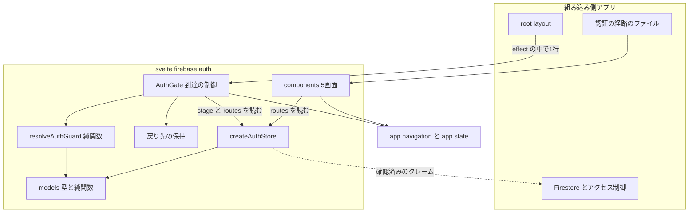
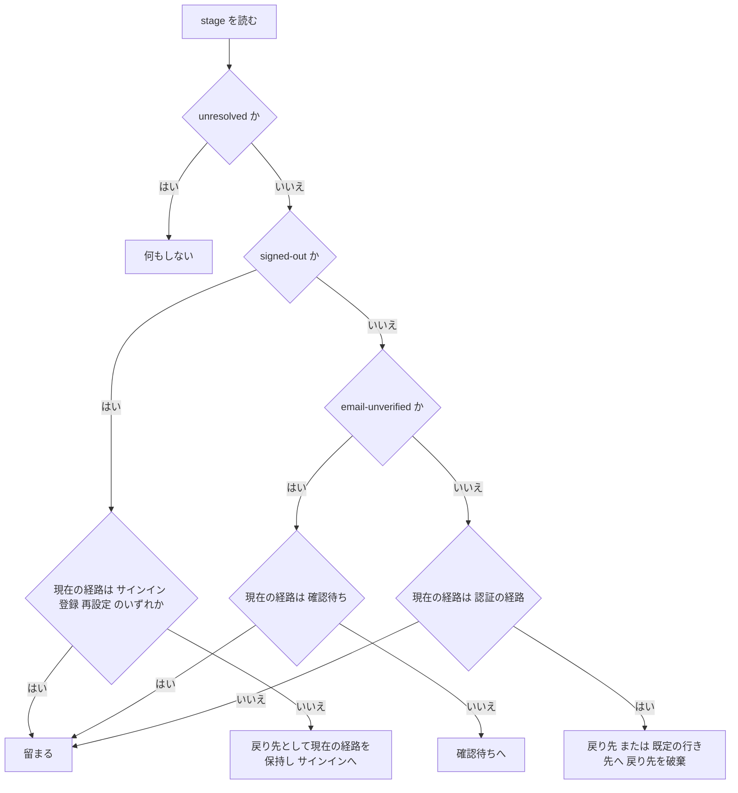
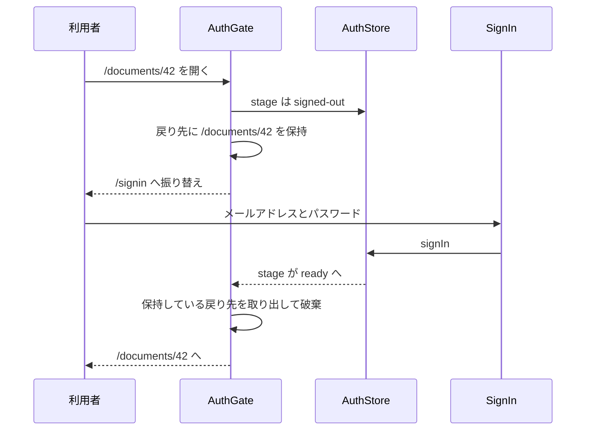

# Technical Design

## Overview

**Purpose**: 認証の**遷移**と**到達ガード**をライブラリ側へ移し、組み込み側に残る配線を無くす。現在は5画面が 13 本のコールバックを持ち、段階から遷移への対応づけを組み込み先ごとに書き直す形になっている。

**Users**: SvelteKit のアプリケーションの開発者。最初の組み込み先は `markn`。

**Impact**: 前提を SvelteKit に固定する。`tech.md`「SvelteKit に依存しない」を置き換え、`$app/navigation` と `$app/state` に依存する。画面の props からコールバックが消え、`AuthConfig` に経路が加わる。**公開面の破壊的変更**だが、公開前（v0.1.0 未リリース）で組み込み先が無いため実害は無い。

### Goals

- 5画面のコールバック 13 本を公開面から無くし、画面が自ら遷移する
- 認証の段階に応じた到達の振り替えを、組み込み側が1行で有効にできる形で提供する
- **サインイン後に、開こうとしていた経路へ戻す**（現在は URL を読めないため未実装）
- 経路の出所を1つにし、画面とガードが同じ値を使う

### Non-Goals

- Firebase の初期化、Firestore とアクセス制御（いずれも組み込み側）
- サーバ側のセッション検証（Admin SDK を要する）
- 認証の画面の中身（入力・検証・文言・エラーの語彙）の変更
- SvelteKit 以外のフレームワークへの対応

## Boundary Commitments

### This Spec Owns

- **認証の経路の設定** — `AuthRoutes` と、その保持・公開
- **到達の判定** — 段階・現在の経路・戻り先から「留まる／振り替える」を決める規則
- **到達の振り替え** — `goto` の呼び出しと、履歴の扱い
- **戻り先の保持と復帰** — 保持先、受け入れる値の形、破棄の時点
- **画面が行う導線の遷移** — 段階を変えない遷移

### Out of Boundary

- **認証の段階そのもの**（`AuthStore.stage`）— `auth-store-and-screens` が所有する。本 spec は読むだけ
- **アクセス制御** — ガードは体験のための仕組みであり、防御ではない
- **組み込み側の経路の実体**（`+page.svelte` の配置）— 経路の値を受け取るだけで、ファイルは持たない
- **画面の中身** — 入力・エラーの提示・文言は変えない

### Allowed Dependencies

- `@sveltejs/kit`（peer, P0）— `$app/navigation` の `goto`、`$app/state` の `page`
- `svelte`（peer, P0）、`firebase`（peer, P0）、`@14ch/svelte-ui`（peer, P1）— 既存
- 依存の向きは **models → stores → components** の一方向

### Revalidation Triggers

- `AuthRoutes` の項目の増減
- 画面の props の形の変更
- `AuthStage` の段階の増減（判定の網羅に波及する）
- `AuthGateProps` の変更（組み込み側の `+layout.svelte` に直結する）

## Architecture

### Existing Architecture Analysis

`auth-store-and-screens` が作った構成を引き継ぐ。**ストア層は変更しない**（`stage` は既にガードが読む形で存在する）。models / messages とそのテスト 818 行はそのまま通る。

守るべき既存の制約:

- Firebase Auth の呼び出しは `stores/` だけが行う。画面は `firebase/auth` を import しない
- 例外を投げず、失敗は戻り値で返す
- 意匠の値は `@14ch/svelte-ui` のトークンを参照する

**本設計が加えるのは `$app/*` への依存だけ**であり、上記は崩れない。

### Architecture Pattern & Boundary Map



**Architecture Integration**:

- **Selected pattern**: 判定（純関数）と効果（薄い包み）の分離。`page.url` がテスト環境で空になり `goto` が例外を投げるため、判定を効果から切り離さないと**分岐のどれも単体で試験できない**（→ `research.md`）
- **Domain boundaries**: 判定は `models/` に置き、購読も遷移も持たない。**`$app/*` とブラウザの保存領域に触るのは `components/` だけ**
- **New components rationale**: `resolveAuthGuard`（判定の純関数）と `AuthGate`（到達の制御）の2つ。**遷移と描画は分けられない** — 遷移だけを止めても判定が済むまで中身が見えるため（要件 4-8）、両方を持つ1つの包みにする。遷移を専用モジュールへ集約する案は採らない — 経路はストアから読めるため、間接を足す動機が「テストの差し替え1行を省く」ことに帰着する（→ `research.md`）
- **Steering compliance**: 例外を投げない／シングルトンにしない／独自のパレットを持たない。**`$app/*` を import しない規則は本 spec が置き換える**（要件 7-1）

**依存の向き（違反は誤りとして扱う）**: `models` → `stores` → `components`。`models` はいずれの層も参照しない。**`resolveAuthGuard` は `$app/*` も保存領域も参照しない。**

### Technology Stack

| Layer      | Choice / Version                       | Role in Feature                  | Notes                                                     |
| ---------- | -------------------------------------- | -------------------------------- | --------------------------------------------------------- |
| Frontend   | Svelte 5.56+（runes）                  | 画面とガードの効果               | 既存。peer                                                |
| Routing    | **`@sveltejs/kit` 2.70+**              | `goto` と `page`                 | **peer。新規の依存**。`svelte-package` が未宣言を警告する |
| Auth SDK   | `firebase` 12.18+                      | 既存。変更なし                   | —                                                         |
| UI 部品    | `@14ch/svelte-ui` 0.0.61+              | 既存。変更なし                   | —                                                         |
| Test       | Vitest 4（client / server / emulator） | 判定は `server`、画面は `client` | **`client` に `$app/navigation` の差し替えを追加**        |
| Test (E2E) | Playwright 1.60+                       | ガードの効果を確かめる唯一の手段 | 既存                                                      |

**新規の依存**: `@sveltejs/kit` は既に devDependencies にある。**peerDependencies への宣言を追加する**。

## File Structure Plan

### Directory Structure

```
src/lib/
├── index.ts                            # 公開面
├── models/auth/
│   ├── auth.types.ts                   # AuthRoutes / AuthGuardDecision を追加。props からコールバックを外す
│   ├── auth.constants.ts               # 変更なし
│   ├── auth.ts                         # 変更なし
│   └── authGuard.ts                    # resolveAuthGuard（純関数。$app/* を参照しない）
├── messages/                           # 変更なし
├── stores/
│   └── auth.svelte.ts                  # routes を公開する（他は変更なし）
└── components/
    ├── AuthGate.svelte                 # 到達の制御。goto・描画の抑止・戻り先の保持
    └── ...                             # 5画面。コールバックを外し goto を呼ぶ

src/routes/                             # ショーケース。経路として組み直す
├── +layout.svelte                       # ストアの生成と start/stop、AuthGate で子を包む
├── +page.svelte                         # 認証を終えた利用者の画面
├── signin/+page.svelte
├── signup/+page.svelte
├── verify-email/+page.svelte
├── password-reset/+page.svelte
└── password-change/+page.svelte

src/tests/
├── models/auth/authGuard.test.ts       # 判定の網羅（新規）
│                                        # 戻り先の受け入れの判定もここで網羅する
└── components/*.svelte.spec.ts         # 検証の対象を「遷移の呼び出し」へ変える
```

### Modified Files

- `package.json` — `peerDependencies` に `@sveltejs/kit` を追加
- `vite.config.ts` — `client` プロジェクトの `setupFiles` に `$app/navigation` の差し替えを追加
- `src/lib/models/auth/auth.types.ts` — `AuthRoutes` / `AuthGuardDecision` を追加。`AuthConfig` に `routes` を追加。5画面の props からコールバックを削除
- `src/lib/stores/auth.svelte.ts` — `routes` の getter を追加
- `src/lib/components/*.svelte`（5件）— コールバックの呼び出しを `goto` へ置き換え
- `src/tests/components/*.svelte.spec.ts`（5件・601行）— 検証の対象が変わる
- `src/routes/` — 画面切り替えを廃し、経路として組み直す
- `src/tests/e2e/showcase.e2e.ts` — 経路に対する検証へ
- `README.md` — 経路の用意・ガードの有効化・戻り先
- `.kiro/steering/tech.md` — 「SvelteKit に依存しない」を置き換える
- `.kiro/specs/auth-store-and-screens/requirements.md` — 要件 1-2 / 9-3 を書き換える（**番号は動かさない**）

## System Flows

### 到達ガードの判定



**流れの上の決定**

- **`unresolved` では遷移しない。** 「まだ分からない」を「サインインしていない」と扱うと、再読み込みのたびにサインインへ飛ばされる
- **各段階は「その段階のための経路」を許す。** 許さないと、振り替え先がふたたび振り替えの対象になり遷移が止まらない
- **振り替えは履歴に残さない**（`replaceState: true`）。残すと戻るボタンで振り替え前へ戻り、再び振り替えられる

### サインイン後に元の経路へ戻る



**流れの上の決定**

- **保持するのは根からの相対パスだけ。** 外部を指し得ない形にすることで、オリジンの照合を各所で行う必要が無くなる
- **確認待ちを経由しても失わない。** `sessionStorage` に置くため、再読み込みと経路の移動を跨ぐ
- **認証の経路そのものは戻り先にしない**（要件 5-6）。サインインの後にサインインへ戻ると遷移が止まらない

## Requirements Traceability

| Requirement  | Summary                            | Components                  | Interfaces                              | Flows            |
| ------------ | ---------------------------------- | --------------------------- | --------------------------------------- | ---------------- |
| 1.1          | peer 依存の宣言                    | PackagingAndShowcase        | `package.json`                          | —                |
| 1.2          | 遷移を自身で行う                   | AuthGate, AuthComponents    | `AuthGate`, `goto`                      | 到達ガードの判定 |
| 1.3          | 入口は1つ                          | PublicSurface               | `index.ts`                              | —                |
| 1.4          | 1箇所で有効にできる                | AuthGate                    | `AuthGate`                              | —                |
| 1.5          | 型を併せて公開する                 | PublicSurface               | `AuthRoutes`, `AuthGuardDecision`       | —                |
| 2.1–2.2      | 経路の設定と単一の出所             | AuthStoreFactory            | `AuthConfig.routes`, `AuthStore.routes` | —                |
| 2.3          | 自由登録が無いとき登録へ遷移しない | SignIn                      | —                                       | —                |
| 2.4          | 経路の欠落を型で示す               | AuthModels                  | `AuthRoutes`（必須の項目）              | —                |
| 2.5          | 経路の一致の判定                   | AuthGuardResolver           | `resolveAuthGuard`                      | —                |
| 3.1–3.6      | 画面が行う導線の遷移               | AuthComponents              | `AuthStore.routes`                      | —                |
| 3.7          | 遷移の要求を返さない／完了は返す   | AuthModels                  | `AuthBaseProps.onCompleted`             | —                |
| 4.1–4.5      | 段階ごとの到達の許可と振り替え     | AuthGuardResolver           | `resolveAuthGuard`                      | 到達ガードの判定 |
| 4.6          | 段階の変化に追随する               | AuthGate                    | `AuthGate`                              | —                |
| 4.7          | ブラウザでのみ働く                 | AuthGate                    | —                                       | —                |
| 4.8          | 判定が済むまで描画しない           | AuthGate                    | `AuthGateProps.pending`                 | —                |
| 5.1–5.3, 5.6 | 戻り先の保持・復帰・破棄           | AuthGuardResolver, AuthGate | `resolveAuthGuard`                      | 元の経路へ戻る   |
| 5.4          | 外部への誘導を防ぐ                 | AuthGuardResolver           | `resolveAuthGuard`                      | —                |
| 5.5          | 確認を跨いで失わない               | AuthGate                    | `sessionStorage`                        | 元の経路へ戻る   |
| 6.1–6.5      | 手引きとショーケース               | PackagingAndShowcase        | README, `src/routes/`                   | —                |
| 7.1–7.3      | 記録と組み込み側へ返す事項         | —                           | `tech.md`, `auth-store-and-screens`     | —                |

## Components and Interfaces

| Component            | Domain/Layer   | Intent                                 | Req Coverage           | Key Dependencies                             | Contracts      |
| -------------------- | -------------- | -------------------------------------- | ---------------------- | -------------------------------------------- | -------------- |
| AuthModels           | models         | 経路と判定の型                         | 1.5, 2.4, 3.7          | —                                            | Service        |
| AuthGuardResolver    | models         | 到達の判定（純関数）                   | 4.1–4.5, 5.1–5.3, 5.6  | AuthModels (P0)                              | Service        |
| AuthGate             | components     | 到達の制御（遷移・描画・戻り先の保持） | 1.2, 1.4, 4.6–4.8, 5.5 | AuthGuardResolver (P0), `@sveltejs/kit` (P0) | Service, State |
| AuthStoreFactory     | stores         | 経路の保持と公開                       | 2.1, 2.2               | AuthModels (P0)                              | State          |
| AuthComponents       | components     | 導線の遷移                             | 2.3, 3.1–3.7           | AuthStoreFactory (P0), `@sveltejs/kit` (P0)  | —              |
| PublicSurface        | index          | 公開面                                 | 1.3, 1.5               | すべて (P0)                                  | —              |
| PackagingAndShowcase | build / routes | peer 依存・README・経路のショーケース  | 1.1, 6.1–6.5           | —                                            | —              |

### models

#### AuthModels

| Field        | Detail                               |
| ------------ | ------------------------------------ |
| Intent       | 経路と判定の型。購読も遷移も持たない |
| Requirements | 1.5, 2.4, 3.7                        |

**Responsibilities & Constraints**

- 経路は**すべて必須の項目**とし、欠落を実行時の分岐として抱え込まない（要件 2-4）
- 画面の props から**コールバックを削除する**（要件 3-7）

##### Service Interface

```typescript
/** 認証の経路。組み込み側の URL 構成を受け取る */
export interface AuthRoutes {
	readonly signIn: string;
	readonly signUp: string;
	readonly verifyEmail: string;
	readonly passwordReset: string;
	/** 認証を終えた利用者の既定の行き先 */
	readonly afterSignIn: string;
}

export interface AuthConfig {
	readonly selfRegistration: boolean;
	readonly emailVerification: boolean;
	readonly continueUrl: string;
	readonly routes: AuthRoutes;
}

/** 到達ガードの判定。効果を持たない */
export type AuthGuardDecision =
	/** 初回の判定が未了。何もしない */
	| { readonly kind: 'wait' }
	/** 現在の経路に留まってよい */
	| { readonly kind: 'allow' }
	| {
			readonly kind: 'redirect';
			readonly to: string;
			/** 振り替えの後に保持すべき戻り先。null は破棄を意味する */
			readonly returnTo: string | null;
	  };

/** 画面の共通の props。遷移の要求も、題字などのページの要素も持たない */
export interface AuthBaseProps {
	readonly store: AuthStore;
	readonly messages?: AuthMessagesOverride;
	/** 画面の役目が果たされたときに呼ばれる。**遷移は行わない**。省略できる */
	readonly onCompleted?: () => void;
}
```

- **Invariants**: 5画面の props は `AuthBaseProps` のみ。画面ごとの差分は無くなる
- **題字と名乗りは持たない。** 見出しの階層・名乗り・レイアウトはページの要素であり、画面を置く側が決める。差し込み口（`header`）を残すと、その決定がライブラリと組み込み側に分かれる。題字の文言（`signInTitle` ほか5項目）も `AuthMessages` から外す（実装中の依頼者の判断。→ `auth-store-and-screens` 要件 9-6 の注）

**Implementation Notes**

- Integration: `SignInProps` 以下 5 種の型は、差分が無くなるため**廃止して `AuthBaseProps` に一本化する**。組み込み側が画面ごとの型を書く必要が無くなる
- Risks: 型の廃止は破壊的変更（→ Revalidation Triggers）

#### AuthGuardResolver

| Field        | Detail                                                           |
| ------------ | ---------------------------------------------------------------- |
| Intent       | 段階・現在の経路・設定・戻り先から、留まるか振り替えるかを決める |
| Requirements | 4.1–4.5, 5.1–5.3, 5.6                                            |

**Responsibilities & Constraints**

- **`$app/*` を参照しない。** 副作用を持たず、同じ入力に同じ判定を返す
- **各段階は「その段階のための経路」を許す。** 振り替え先が振り替えの対象になる状態を作らない
- 戻り先の保持と破棄を判定として返す（実際の保存は `AuthGate` が行う）
- **受け入れられない戻り先を、持っていないものとして扱う。** 受け入れるのは根からの相対の経路だけで、`//evil.example` と `/\evil.example` はブラウザが外部として解決するため弾く（要件 5-4）

**Dependencies**

- Outbound: AuthModels — 型（P0）

**Contracts**: Service [x] / State [ ]

##### Service Interface

```typescript
export interface AuthGuardInput {
	readonly stage: AuthStage;
	/** 現在の経路。根からの相対パス（pathname と search） */
	readonly currentPath: string;
	readonly routes: AuthRoutes;
	/** 保持されている戻り先。無ければ null */
	readonly returnTo: string | null;
}

export declare function resolveAuthGuard(input: AuthGuardInput): AuthGuardDecision;
```

**経路の一致の規則**（要件 2-5）

- **`pathname` のみで比較する。** 問い合わせ文字列は比較に用いない（戻り先として保持するときには残す）
- **末尾のスラッシュを取り除いて正規化し、完全一致とする。** `/signin` と `/signin/` は同じ経路とみなす
- **前方一致にしない。** `/signin` が `/signin-help` や `/signin/detail` に当たると、振り替え先が振り替えの対象から外れ、遷移が止まらなくなる

- **Preconditions**: `currentPath` は `/` で始まる
- **Postconditions**:
  - `stage` が `unresolved` のとき、必ず `wait` を返す
  - `redirect` を返すとき、`to` に振り替えた先で同じ入力を与えると `allow` または `wait` になる（**振り替えが止まる**）
  - 認証の経路を `returnTo` として返さない
- **Invariants**: 副作用を持たない

**Implementation Notes**

- Integration: 「認証の経路」は `signIn` / `signUp` / `verifyEmail` / `passwordReset` の4つ。**`afterSignIn` と、そこに含まれない経路（パスワードの変更など）は認証の経路ではない**
- Validation: 段階4種 × 経路の種類 × 戻り先の有無を、`server` プロジェクトの単体テストで網羅する。**受け入れられない戻り先（`//evil`、`/\evil`、`https://evil`、空文字、`../`）が用いられも保持し直されもしないこと**も、ここで確かめる。**すべての `redirect` について、振り替え先で止まることを確かめる**。経路の一致は、問い合わせ文字列付き・末尾スラッシュ付き・前方一致になる紛らわしい経路（`/signin-help`）で確かめる
- Risks: 段階が増えると網羅が漏れる。`AuthStage` は判別可能な共用体であり、`switch` の網羅性で検出できる

### stores

#### AuthStoreFactory

| Field        | Detail                                                         |
| ------------ | -------------------------------------------------------------- |
| Intent       | 経路の保持と公開。他は `auth-store-and-screens` から変更しない |
| Requirements | 2.1, 2.2                                                       |

**Responsibilities & Constraints**

- `AuthConfig.routes` を受け取り、`AuthStore.routes` として公開する
- **経路の出所を1つにする。** 画面もガードもここから読む（要件 2-2）

**Contracts**: State [x]

##### State Management

- **状態モデル**: `routes` は設定から導く（状態を持たない）。`canSelfRegister` / `requiresEmailVerification` と同じ形

**Implementation Notes**

- Integration: `AuthStore` に `readonly routes: AuthRoutes` を追加する。**他の振る舞いは変更しない**

### components

#### AuthGate

| Field        | Detail                                                           |
| ------------ | ---------------------------------------------------------------- |
| Intent       | 到達の制御。判定に従って遷移し、判定が済むまで中身を描画させない |
| Requirements | 1.2, 1.4, 4.6, 4.7, 4.8                                          |

**Responsibilities & Constraints**

- **判定を持たない。** `resolveAuthGuard` の結果に従うだけ。**受け入れてよい戻り先かの判定も持たない**
- **戻り先を `sessionStorage` の単一のキーへ保持する。** タブ単位で再読み込みと経路の移動を跨ぐ。保持先が使えない環境でも例外を投げず、戻り先を持たない状態として振る舞う
- **遷移と描画を対で持つ。** 遷移だけを止めても、判定が済むまで保護された経路の中身が画面に出る（要件 4-8）
- **組み込み側は根の `+layout.svelte` で子を包む**（要件 1-4）
- `store.stage` と `page.url` の双方を読むため、**どちらが変わっても走る**（要件 4-6）
- ブラウザでのみ働く（要件 4-7）
- **実行中の振り替え先を保持し、同じ行き先への `goto` を重ねて出さない**

**Dependencies**

- External: `@sveltejs/kit` — `$app/navigation` の `goto`、`$app/state` の `page`（P0）
- Outbound: AuthGuardResolver（P0）

**Contracts**: Service [x] / State [x]

##### Service Interface

```typescript
export interface AuthGateProps {
	readonly store: AuthStore;
	/** 到達を許された利用者に見せるもの */
	readonly children: Snippet;
	/** 初回の判定が済むまでのあいだ見せるもの。省略時は何も描画しない */
	readonly pending?: Snippet;
}
```

- **Preconditions**: `store.start()` が呼ばれていること
- **Postconditions**:
  - `wait` のあいだ `children` を描画せず、`pending` があればそれを描画する
  - `allow` のとき `children` を描画する
  - `redirect` のとき `goto(to, { replaceState: true })` を行い、`returnTo` を保持または破棄する。**遷移が終わるまで `children` を描画しない**
- **Invariants**: 同じ行き先への振り替えを重ねて出さない

##### State Management

- **状態モデル**: 実行中の振り替え先（`string | null`）のみ。`page.url` が振り替え先へ変わった時点で解除する
- **並行性**: `goto` は非同期であり、遷移の完了前に段階が変わると効果が再び走る。**実行中の行き先と同じであれば何もしない**ことで、重複した遷移を抑える

**Implementation Notes**

- Integration: 振り替えは `replaceState: true`。**利用者の操作による遷移（画面の導線）は通常どおり履歴へ積む**
- Integration: 認証の経路（サインインなど）自体もこの包みの中に置かれる。`allow` と判定されるため描画される
- Validation: **単体では試験しない**（ルーター無しでは `goto` が例外を投げ、`page.url` が空になる）。E2E で確かめる
- Risks: 保持先の try/catch は単体では試験できない（ルーター無しでは `goto` が例外を投げる）。E2E が唯一の検証手段になる
- Risks: 包み忘れるとガードが働かない。**画面の出し分けは体験のためであり、防御は組み込み側のアクセス制御が担う**ことを README に記す

#### 5画面

5画面はいずれも `AuthBaseProps` だけを受け取る。導線の遷移は `goto(store.routes.x)` を呼ぶ。

**すべての画面に共通する制約**

- **完了時に自ら遷移しない。** サインイン・登録・確認・サインアウトの完了は段階を変えるため、ガードが動かす（要件 3 の注）。**段階を変えない完了（パスワードの変更）は、ガードも動かない。** その画面は完了の状態へ切り替え、次の一手を自分で示す（要件 3-8）
- **完了は `onCompleted` で組み込み側へ返す。** 遷移は行わない。段階を変える完了ではガードが動くため記録や通知に使い、**段階を変えない完了では、行き先を決められるのは組み込み側だけ**である。渡さない場合の既定を画面が持ち、行き止まりを作らない
- **段階を変えない導線だけを自ら遷移する**
- 入力・エラーの提示・処理中の表示・文言は**変更しない**

| 画面           | 自ら行う遷移                                     | 対応する要件  |
| -------------- | ------------------------------------------------ | ------------- |
| SignIn         | 再設定へ／（自由登録が許可されているとき）登録へ | 2.3, 3.1, 3.2 |
| SignUp         | サインインへ／（登録済みのとき）再設定へ         | 3.3           |
| VerifyEmail    | サインアウトを終えてから登録へ                   | 3.4           |
| PasswordChange | 取りやめで既定の行き先へ／完了後の戻る導線       | 3.5, 3.8      |
| PasswordReset  | サインインへ                                     | 3.6           |

**Implementation Notes**

- Integration: PasswordChange の完了は段階を変えないため、**到達の制御は利用者を動かさない**。完了したまま操作を並べておくと、押せる意味のないものだけが残る（「変更する」は現在のパスワードが変わったため必ず失敗し、「取りやめる」は取りやめるものが無い）。完了したら入力欄と変更の操作を出さず、既定の行き先へ戻る導線を1つだけ出す。変更したパスワードも画面に残さない
- Integration: VerifyEmail の「別のメールアドレスで登録し直す」は、**サインアウトを終えてから**登録の経路へ遷移する。サインアウトで段階が `signed-out` になるが、登録の経路は `signed-out` が許す経路であるため、ガードと競合しない
- Validation: 各画面のテストは、コールバックの呼び出しではなく**遷移の呼び出し**を検証する。`$app/navigation` を `client` の設定ファイルで差し替える
- Risks: 601 行のテストの検証対象が変わるため、書き替えの間は回帰の検出網が薄くなる

### index / build

#### PublicSurface

**Responsibilities & Constraints**

- **入口は1つに保つ**（要件 1-3）。SvelteKit 向けの第2の入口を作らない
- 追加で公開するもの: `AuthGate`、型 `AuthRoutes` / `AuthGateProps`
- **`resolveAuthGuard` と戻り先の保持は公開しない。** `AuthGate` の内部実装であり、組み込み側が直接使う要求が無い（「迷ったら公開しない」）
- 廃止するもの: `SignInProps` 以下 5 種の props の型（`AuthBaseProps` に一本化）

#### PackagingAndShowcase

**Responsibilities & Constraints**（要件 1.1, 6.1–6.5）

- `@sveltejs/kit` を peer で宣言する
- README に、**組み込み側が用意する経路**と、**ガードを有効にする1行**を書く
- ショーケースを SvelteKit の経路として組み直す。**自前の画面切り替えを残さない**（残すと、ライブラリの遷移とガードを通らない経路でしか確かめられない）

## Data Models

**新しい永続データを1つだけ持つ。** 戻り先の経路である。

- **戻り先** — `sessionStorage` の単一のキー。タブ単位で、再読み込みを跨いで保持する。**認証の状態は保持しない**
- **不変条件**: 保持される値は根からの相対パス（`/` で始まり `//` で始まらない）
- **`auth-store-and-screens` の「新しい永続データを持たない」からの逸脱**であり、意図的なものとして記録する（→ `research.md`）

## Error Handling

### Error Strategy

本 spec が加える失敗は、**遷移そのものの失敗**と**保持先が使えないこと**の2つに限られる。認証の操作の失敗（語彙・文言）は `auth-store-and-screens` のままで変更しない。

### Error Categories and Responses

| 種別                   | 状況                               | 応答                                                                     |
| ---------------------- | ---------------------------------- | ------------------------------------------------------------------------ |
| 保持先が使えない       | `sessionStorage` が無効            | 例外を握りつぶし、戻り先を持たない状態として振る舞う。既定の行き先へ進む |
| 受け入れられない戻り先 | 外部を指す値・空文字               | 保持せず、既定の行き先を用いる                                           |
| 遷移の失敗             | `goto` が失敗する                  | ガードは次の変化で再び走る。利用者の操作を妨げない                       |
| ガードの包み忘れ       | 組み込み側が `AuthGate` で包まない | **検出できない。** README とショーケースで書き方を示す                   |

### Monitoring

ライブラリは記録の手段を持たない。ガードの振り替えを記録するかどうかは組み込み側が決める。

## Testing Strategy

受け入れ条件は `requirements.md` から引く。各テストに対応する要件の項番を書く（`conventions.md`「テストの由来」）。

### Unit Tests（`server` プロジェクト）

- `resolveAuthGuard` が、**段階4種すべて**について正しい判定を返すこと — 4.1–4.5
- **すべての `redirect` について、振り替え先で `allow` または `wait` になること**（遷移が止まる）— 4.2, 4.3, 4.4
- `signed-out` のとき、認証の経路には留まり、それ以外は戻り先を保持してサインインへ振り替えること — 4.2, 5.1
- `ready` のとき、認証の経路からは戻り先または既定の行き先へ振り替え、それ以外は留まること — 4.4, 4.5, 5.2, 5.3
- 認証の経路を戻り先として保持しないこと — 5.6
- `isSafeReturnTo` が `//evil.example` と `https://evil.example` を弾くこと — 5.4

### Component Tests（`client` プロジェクト）

- 各画面の導線が、設定された経路へ遷移すること — 3.1–3.6
- 自由登録が許可されていないとき、登録への導線が出ないこと — 2.3
- **画面が完了時に遷移しないこと** — 3 の注
- 入力・エラーの提示・処理中の表示が**変わっていないこと**（回帰）— `auth-store-and-screens` の要件

### E2E Tests（ショーケース）

**`AuthGate` の効果を確かめる唯一の手段である。**

- 未サインインで保護された経路を開くと、サインインへ振り替えられること — 4.2
- **判定が済むまで、保護された経路の中身が画面に出ないこと** — 4.8
- **サインインの後、開こうとしていた経路へ戻ること** — 5.1, 5.2
- 未確認のまま再読み込みしても、確認待ちを素通りしないこと — 4.3, 4.6
- 振り替えの後に戻るボタンを押しても、振り替え前の経路に留まらないこと — 4 の注
- 振り替えの最中に段階が変わっても、二重に遷移しないこと — 4.6
- サインイン済みの利用者がサインインの経路を開くと、既定の行き先へ送られること — 4.4

## Security Considerations

- **戻り先を根からの相対パスに限る。** 外部の URL を戻り先に仕込むことで、組み込み先のサインイン画面を踏み台にした誘導が成立することを防ぐ。**`//evil.example` の形を弾くことが要点**（要件 5-4）
- **ガードは防御ではない。** ブラウザでのみ働き、組み込み側が呼び忘れれば働かない。**防御は組み込み側のアクセス制御が担う。ガードがあることを理由にセキュリティルールを緩めない**（要件 4-7 の注）
- 戻り先は認証の状態を含まない。保持するのは経路だけである
